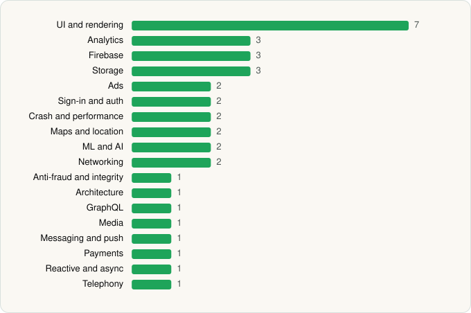

<picture><source media="(prefers-color-scheme: dark)" srcset="../../../../assets/logo/logo-dark.svg"></picture> [Tech Stack](../../../../README.md) / [Microsoft Corporation](../../../../companies/microsoft-corporation.md) / Microsoft Outlook

# Microsoft Outlook

<picture><source media="(prefers-color-scheme: dark)" srcset="../../../../assets/badges/android-dark.svg"></picture> <picture><source media="(prefers-color-scheme: dark)" srcset="../../../../assets/badges/inactive-dark.svg"></picture> <picture><source media="(prefers-color-scheme: dark)" srcset="../../../../assets/badges/floor-dark.svg"></picture>

[Google Play](https://play.google.com/store/apps/details?id=com.microsoft.office.outlook) · [latest.json](latest.json)

| | |
|---|---|
| Company | [Microsoft Corporation](../../../../companies/microsoft-corporation.md) |
| Store id | `com.microsoft.office.outlook` |
| Bundle / package id | `com.microsoft.office.outlook` |
| Latest version | 5.2606.0 (analysed 2026-06-19) |
| Versions tracked | 1 |
| SDKs in latest version | 36 |
| Languages | C/C++ (native), Java, Kotlin, React Native / JavaScript |
| UI | Coil, Jetpack Compose, Lottie, Material Components, Picasso |
| Build | Gradle (inferred), R8 / ProGuard (name obfuscation detected) |
| Minimum OS | API 29, targets API 35 |
| Devices / ABIs | Android |
| Capabilities | 16 |
| Declares tracking | Yes |
| Tracked | No. Kept for history. |

## SDKs by category

<picture><source media="(prefers-color-scheme: dark)" srcset="../../../../assets/charts/apps/android/microsoft-corporation/microsoft-outlook-dark.svg"></picture>

- **UI and rendering** (7): AndroidSVG, Coil, Jetpack Compose, Lottie, Markwon, Material Components, Picasso
- **Analytics** (3): Amplitude, Branch, Singular
- **Firebase** (3): Firebase, Google DataTransport, Google Play services
- **Storage** (3): DataStore, Okio, Room
- **Ads** (2): Google Mobile Ads (AdMob), Meta Audience Network
- **Sign-in and auth** (2): Credential Manager, Google Sign-In / Auth
- **Crash and performance** (2): App Center, OpenTelemetry
- **Maps and location** (2): Google Location, Google Maps
- **ML and AI** (2): ML Kit, ML Kit (barcode/vision)
- **Networking** (2): OkHttp, Retrofit
- **Anti-fraud and integrity** (1): Play Integrity
- **Architecture** (1): Redux
- **GraphQL** (1): Apollo GraphQL
- **Media** (1): Media3 (ExoPlayer)
- **Messaging and push** (1): Firebase Messaging
- **Payments** (1): Google Play Billing
- **Reactive and async** (1): Kotlin Coroutines
- **Telephony** (1): libphonenumber

Capabilities (16)

Advertising ID, Approximate location, Biometric auth, Calendar (read), Calendar (write), Camera, Contacts (read), Contacts (write), Fingerprint auth, Foreground service, Microphone, NFC, Notifications, Precise location, Storage (read), Storage (write)

## Version history

| Version | Analysed | Store update | SDKs | Change | SDK list is a floor | Binary encrypted | File |
|---|---|---|---|---|---|---|---|
| 5.2606.0 | 2026-06-19 |  | 36 |  | Yes | No | [5.2606.0.json](5.2606.0.json) |

## Model-written summary

> Hybrid React Native/Hermes + Jetpack Compose Android Outlook bundling TFLite ML models, Office Lens native SDK, Microsoft/aria backends, and 36 third-party SDKs

Written by a language model from the detected signals (`inferred[]`). It is commentary, not measurement.

---

Generated by `scripts/build_readme.py` from the JSON files. Do not edit by hand.
