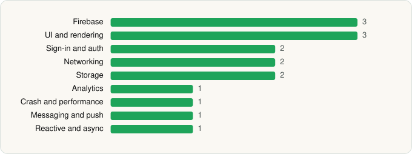

<picture><source media="(prefers-color-scheme: dark)" srcset="../../../../assets/logo/logo-dark.svg"></picture> [Tech Stack](../../../../README.md) / [Microsoft Corporation](../../../../companies/microsoft-corporation.md) / Microsoft Planner

# Microsoft Planner

<picture><source media="(prefers-color-scheme: dark)" srcset="../../../../assets/badges/android-dark.svg"></picture> <picture><source media="(prefers-color-scheme: dark)" srcset="../../../../assets/badges/inactive-dark.svg"></picture>

[Google Play](https://play.google.com/store/apps/details?id=com.microsoft.planner) · [latest.json](latest.json)

| | |
|---|---|
| Company | [Microsoft Corporation](../../../../companies/microsoft-corporation.md) |
| Store id | `com.microsoft.planner` |
| Bundle / package id | `com.microsoft.planner` |
| Latest version | 1.18.38 (analysed 2026-06-19) |
| Versions tracked | 1 |
| SDKs in latest version | 16 |
| Languages | C/C++ (native), Java, Kotlin |
| UI | Jetpack Compose, Material Components, Picasso |
| Build | Gradle (inferred) |
| Minimum OS | API 24, targets API 35 |
| Devices / ABIs | Android |
| Capabilities | 6 |
| Declares tracking | Yes |
| Tracked | No. Kept for history. |

## SDKs by category

<picture><source media="(prefers-color-scheme: dark)" srcset="../../../../assets/charts/apps/android/microsoft-corporation/microsoft-planner-dark.svg"></picture>

- **Firebase** (3): Firebase, Google DataTransport, Google Play services
- **UI and rendering** (3): Jetpack Compose, Material Components, Picasso
- **Sign-in and auth** (2): Credential Manager, Google Sign-In / Auth
- **Networking** (2): OkHttp, Retrofit
- **Storage** (2): DataStore, Okio
- **Analytics** (1): Firebase Analytics
- **Crash and performance** (1): OpenTelemetry
- **Messaging and push** (1): Firebase Messaging
- **Reactive and async** (1): Kotlin Coroutines

Capabilities (6)

Camera, Foreground service, NFC, Notifications, Phone / carrier info, Storage (write)

## Version history

| Version | Analysed | Store update | SDKs | Change | SDK list is a floor | Binary encrypted | File |
|---|---|---|---|---|---|---|---|
| 1.18.38 | 2026-06-19 |  | 16 |  | No | No | [1.18.38.json](1.18.38.json) |

---

Generated by `scripts/build_readme.py` from the JSON files. Do not edit by hand.
