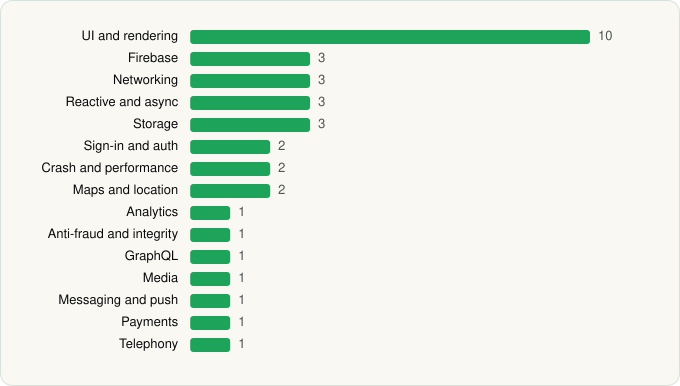

<picture><source media="(prefers-color-scheme: dark)" srcset="../../../../assets/logo/logo-dark.svg"></picture> [Tech Stack](../../../../README.md) / [Microsoft Corporation](../../../../companies/microsoft-corporation.md) / Microsoft Teams

# Microsoft Teams

<picture><source media="(prefers-color-scheme: dark)" srcset="../../../../assets/badges/android-dark.svg"></picture> <picture><source media="(prefers-color-scheme: dark)" srcset="../../../../assets/badges/inactive-dark.svg"></picture>

[Google Play](https://play.google.com/store/apps/details?id=com.microsoft.teams) · [latest.json](latest.json)

| | |
|---|---|
| Company | [Microsoft Corporation](../../../../companies/microsoft-corporation.md) |
| Store id | `com.microsoft.teams` |
| Bundle / package id | `com.microsoft.teams` |
| Latest version | 1416/1.0.0.2026082702 (analysed 2026-06-19) |
| Versions tracked | 1 |
| SDKs in latest version | 36 |
| Languages | C/C++ (native), Java, Kotlin, React Native / JavaScript |
| UI | Coil, Fresco, Glide, Jetpack Compose, Lottie, Material Components, Picasso |
| Build | Gradle (inferred) |
| Minimum OS | API 30, targets API 35 |
| Devices / ABIs | Android |
| Capabilities | 21 |
| Declares tracking | Yes |
| Tracked | No. Kept for history. |

## SDKs by category

<picture><source media="(prefers-color-scheme: dark)" srcset="../../../../assets/charts/apps/android/microsoft-corporation/microsoft-teams-dark.svg"></picture>

- **UI and rendering** (10): AndroidSVG, Coil, Fresco, Glide, Jetpack Compose, jLaTeXMath, Lottie, Markwon, Material Components, Picasso
- **Storage** (4): DataStore, greenDAO, Okio, Room
- **Firebase** (3): Firebase, Google DataTransport, Google Play services
- **Networking** (3): OkHttp, Retrofit, Volley
- **Reactive and async** (3): Kotlin Coroutines, RxJava, RxJava 3
- **Sign-in and auth** (2): Credential Manager, Google Sign-In / Auth
- **Crash and performance** (2): App Center, OpenTelemetry
- **Maps and location** (2): Google Location, Google Maps
- **Analytics** (1): Firebase Analytics
- **Anti-fraud and integrity** (1): Play Integrity
- **GraphQL** (1): Apollo GraphQL
- **Media** (1): Media3 (ExoPlayer)
- **Messaging and push** (1): Firebase Messaging
- **Payments** (1): Google Play Billing
- **Telephony** (1): libphonenumber

Capabilities (21)

Approximate location, Bluetooth, Bluetooth (connect), Bluetooth (scan), Camera, Contacts (read), Contacts (write), Draw over other apps, Foreground service, Foreground service: media playback, Foreground service: microphone, Media: audio, Media: images, Media: video, Microphone, NFC, Notifications, Phone / carrier info, Precise location, Storage (read), Storage (write)

## Version history

| Version | Analysed | Store update | SDKs | Change | SDK list is a floor | Binary encrypted | File |
|---|---|---|---|---|---|---|---|
| 1416/1.0.0.2026082702 | 2026-06-19 |  | 36 |  | No | No | [1416_1.0.0.2026082702.json](1416_1.0.0.2026082702.json) |

## Model-written summary

> Android Microsoft Teams: React Native with Hermes, 30+ native libs including OneAuth/SkyLib/Pdfium, Jetpack Compose, and multi-sovereign Microsoft backends

Written by a language model from the detected signals (`inferred[]`). It is commentary, not measurement.

---

Generated by `scripts/build_readme.py` from the JSON files. Do not edit by hand.
