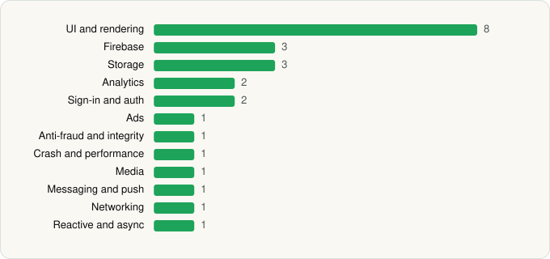

<picture><source media="(prefers-color-scheme: dark)" srcset="../../../../assets/logo/logo-dark.svg"></picture> [Tech Stack](../../../../README.md) / [Microsoft Corporation](../../../../companies/microsoft-corporation.md) / MSN

# MSN

<picture><source media="(prefers-color-scheme: dark)" srcset="../../../../assets/badges/android-dark.svg"></picture> <picture><source media="(prefers-color-scheme: dark)" srcset="../../../../assets/badges/inactive-dark.svg"></picture>

[Google Play](https://play.google.com/store/apps/details?id=com.microsoft.amp.apps.bingnews) · [latest.json](latest.json)

| | |
|---|---|
| Company | [Microsoft Corporation](../../../../companies/microsoft-corporation.md) |
| Store id | `com.microsoft.amp.apps.bingnews` |
| Bundle / package id | `com.microsoft.amp.apps.bingnews` |
| Latest version | 33.3.440518006 (analysed 2026-06-19) |
| Versions tracked | 1 |
| SDKs in latest version | 25 |
| Languages | C/C++ (native), Java, Kotlin |
| UI | Coil, Glide, Jetpack Compose, Lottie, Material Components |
| Build | Gradle (inferred) |
| Minimum OS | API 30, targets API 35 |
| Devices / ABIs | Android |
| Capabilities | 15 |
| Declares tracking | Yes |
| Tracked | No. Kept for history. |

## SDKs by category

<picture><source media="(prefers-color-scheme: dark)" srcset="../../../../assets/charts/apps/android/microsoft-corporation/msn-dark.svg"></picture>

- **UI and rendering** (8): AndroidSVG, Coil, Glide, Jetpack Compose, jLaTeXMath, Lottie, Markwon, Material Components
- **Firebase** (3): Firebase, Google DataTransport, Google Play services
- **Storage** (3): DataStore, Okio, Room
- **Analytics** (2): Adjust, Firebase Analytics
- **Sign-in and auth** (2): Credential Manager, Google Sign-In / Auth
- **Ads** (1): Google Mobile Ads (AdMob)
- **Anti-fraud and integrity** (1): Play Integrity
- **Crash and performance** (1): OpenTelemetry
- **Media** (1): Media3 (ExoPlayer)
- **Messaging and push** (1): Firebase Messaging
- **Networking** (1): OkHttp
- **Reactive and async** (1): Kotlin Coroutines

Capabilities (15)

Advertising ID, Approximate location, Biometric auth, Camera, Draw over other apps, Fingerprint auth, Foreground service, Foreground service: media playback, Microphone, NFC, Notifications, Phone / carrier info, Precise location, Storage (read), Storage (write)

## Version history

| Version | Analysed | Store update | SDKs | Change | SDK list is a floor | Binary encrypted | File |
|---|---|---|---|---|---|---|---|
| 33.3.440518006 | 2026-06-19 |  | 25 |  | No | No | [33.3.440518006.json](33.3.440518006.json) |

## Model-written summary

> Android MSN app with Jetpack Compose UI, bundled Microsoft Cognitive Services Speech natives, Firebase backend, and Microsoft app integrations

Written by a language model from the detected signals (`inferred[]`). It is commentary, not measurement.

---

Generated by `scripts/build_readme.py` from the JSON files. Do not edit by hand.
