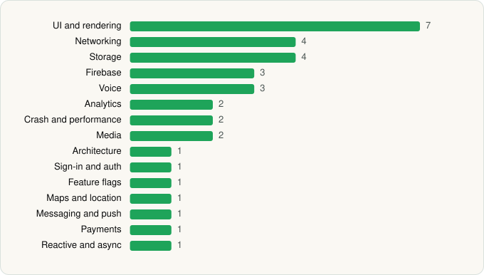

<picture><source media="(prefers-color-scheme: dark)" srcset="../../../../assets/logo/logo-dark.svg"></picture> [Tech Stack](../../../../README.md) / [Mistral AI](../../../../companies/mistral-ai.md) / Le Chat by Mistral AI

# Le Chat by Mistral AI

<picture><source media="(prefers-color-scheme: dark)" srcset="../../../../assets/badges/android-dark.svg"></picture> <picture><source media="(prefers-color-scheme: dark)" srcset="../../../../assets/badges/active-dark.svg"></picture>

[Google Play](https://play.google.com/store/apps/details?id=ai.mistral.chat) · [latest.json](latest.json)

| | |
|---|---|
| Company | [Mistral AI](../../../../companies/mistral-ai.md) |
| Store id | `ai.mistral.chat` |
| Bundle / package id | `ai.mistral.chat` |
| Latest version | 2.16.0 (analysed 2026-10-24) |
| Versions tracked | 1 |
| SDKs in latest version | 34 |
| Languages | C/C++ (native), Java, Kotlin, React Native / JavaScript |
| UI | Fresco, Glide, Jetpack Compose, Material Components |
| Build | Gradle (inferred) |
| Minimum OS | API 24, targets API 36 |
| Devices / ABIs | Android |
| Capabilities | 10 |
| Declares tracking | Yes |
| Tracked | Yes |

## SDKs by category

<picture><source media="(prefers-color-scheme: dark)" srcset="../../../../assets/charts/apps/android/mistral-ai/le-chat-dark.svg"></picture>

- **UI and rendering** (7): AndroidSVG, FlashList, Fresco, Glide, Jetpack Compose, Material Components, React Native Reanimated
- **Networking** (4): axios, Cronet, Cronet (Chromium net), OkHttp
- **Storage** (4): DataStore, Okio, Realm, Room
- **Firebase** (3): Firebase, Google DataTransport, Google Play services
- **Voice** (3): LiveKit, Twilio, WebRTC
- **Analytics** (2): Branch, Firebase Analytics
- **Crash and performance** (2): Sentry, Sentry (native)
- **Media** (2): ExoPlayer, FFmpeg
- **Architecture** (1): MobX
- **Sign-in and auth** (1): Google Sign-In / Auth
- **Feature flags** (1): Statsig
- **Maps and location** (1): Google Location
- **Messaging and push** (1): Firebase Messaging
- **Payments** (1): Google Play Billing
- **Reactive and async** (1): Kotlin Coroutines

Capabilities (10)

Bluetooth, Camera, Draw over other apps, Foreground service, Foreground service: media playback, Foreground service: microphone, Microphone, Notifications, Storage (read), Storage (write)

## Version history

| Version | Analysed | Store update | SDKs | Change | SDK list is a floor | Binary encrypted | File |
|---|---|---|---|---|---|---|---|
| 2.16.0 | 2026-10-24 | 2026-10-21 | 34 |  | No | No | [2.16.0.json](2.16.0.json) |

---

Generated by `scripts/build_readme.py` from the JSON files. Do not edit by hand.
