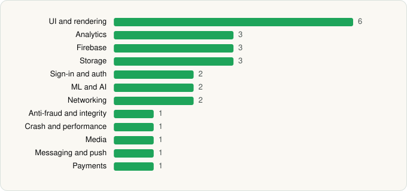

<picture><source media="(prefers-color-scheme: dark)" srcset="../../../../assets/logo/logo-dark.svg"></picture> [Tech Stack](../../../../README.md) / [Moonshot AI](../../../../companies/moonshot-ai.md) / Kimi

# Kimi

<picture><source media="(prefers-color-scheme: dark)" srcset="../../../../assets/badges/android-dark.svg"></picture> <picture><source media="(prefers-color-scheme: dark)" srcset="../../../../assets/badges/active-dark.svg"></picture> <picture><source media="(prefers-color-scheme: dark)" srcset="../../../../assets/badges/floor-dark.svg"></picture>

[Google Play](https://play.google.com/store/apps/details?id=com.moonshot.kimichat) · [latest.json](latest.json)

| | |
|---|---|
| Company | [Moonshot AI](../../../../companies/moonshot-ai.md) |
| Store id | `com.moonshot.kimichat` |
| Bundle / package id | `com.moonshot.kimichat` |
| Latest version | 3.1.5 (analysed 2026-10-24) |
| Versions tracked | 1 |
| SDKs in latest version | 26 |
| Languages | C/C++ (native), Java, Kotlin |
| UI | Coil, Glide, Jetpack Compose, Rive |
| Build | Gradle (inferred), R8 / ProGuard (name obfuscation detected) |
| Minimum OS | API 26, targets API 36 |
| Devices / ABIs | Android |
| Capabilities | 15 |
| Declares tracking | Yes |
| Tracked | Yes |

## SDKs by category

<picture><source media="(prefers-color-scheme: dark)" srcset="../../../../assets/charts/apps/android/moonshot-ai/kimi-dark.svg"></picture>

- **UI and rendering** (6): Coil, Glide, Jetpack Compose, jLaTeXMath, Markwon, Rive
- **Analytics** (3): AppsFlyer, Firebase Analytics, Google App Measurement
- **Firebase** (3): Firebase, Google DataTransport, Google Play services
- **Storage** (3): DataStore, MMKV, Room
- **Sign-in and auth** (2): Credential Manager, Google Sign-In / Auth
- **ML and AI** (2): ML Kit, ML Kit (barcode/vision)
- **Networking** (2): Ktor, OkHttp
- **Anti-fraud and integrity** (1): Play Integrity
- **Crash and performance** (1): Sentry
- **Media** (1): Media3 (ExoPlayer)
- **Messaging and push** (1): Firebase Messaging
- **Payments** (1): Google Play Billing

Capabilities (15)

Advertising ID, Approximate location, Biometric auth, Bluetooth, Camera, Fingerprint auth, Foreground service, Foreground service: media playback, Foreground service: microphone, Microphone, Notifications, Phone / carrier info, Precise location, Storage (read), Storage (write)

## Version history

| Version | Analysed | Store update | SDKs | Change | SDK list is a floor | Binary encrypted | File |
|---|---|---|---|---|---|---|---|
| 3.1.5 | 2026-10-24 | 2026-10-20 | 26 |  | Yes | No | [3.1.5.json](3.1.5.json) |

---

Generated by `scripts/build_readme.py` from the JSON files. Do not edit by hand.
