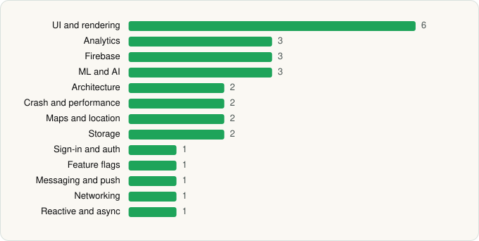

<picture><source media="(prefers-color-scheme: dark)" srcset="../../../../assets/logo/logo-dark.svg"></picture> [Tech Stack](../../../../README.md) / [MorelandConnect](../../../../companies/morelandconnect.md) / BlueSkyVUE

# BlueSkyVUE

<picture><source media="(prefers-color-scheme: dark)" srcset="../../../../assets/badges/android-dark.svg"></picture> <picture><source media="(prefers-color-scheme: dark)" srcset="../../../../assets/badges/inactive-dark.svg"></picture>

[Google Play](https://play.google.com/store/apps/details?id=com.jmireports.bluesky) · [latest.json](latest.json)

| | |
|---|---|
| Company | [MorelandConnect](../../../../companies/morelandconnect.md) |
| Store id | `com.jmireports.bluesky` |
| Bundle / package id | `com.jmireports.bluesky` |
| Latest version | 2.13.0 (analysed 2026-06-19) |
| Versions tracked | 1 |
| SDKs in latest version | 28 |
| Languages | C/C++ (native), Java, Kotlin, React Native / JavaScript |
| UI | Fresco, Glide, Material Components |
| Build | Gradle (inferred) |
| Minimum OS | API 24, targets API 35 |
| Devices / ABIs | Android |
| Capabilities | 14 |
| Declares tracking | Yes |
| Tracked | No. Kept for history. |

## SDKs by category

<picture><source media="(prefers-color-scheme: dark)" srcset="../../../../assets/charts/apps/android/morelandconnect/blueskyvue-dark.svg"></picture>

- **UI and rendering** (6): FlashList, Fresco, Glide, Material Components, React Native Reanimated, react-native-svg
- **Analytics** (3): Amplitude, Branch, Firebase Analytics
- **Firebase** (3): Firebase, Google DataTransport, Google Play services
- **ML and AI** (3): ML Kit, ML Kit (barcode/vision), Mobile Vision
- **Architecture** (2): MobX, Redux
- **Crash and performance** (2): Sentry, Sentry (native)
- **Maps and location** (2): Google Location, Google Maps
- **Storage** (2): Okio, Room
- **Sign-in and auth** (1): Google Sign-In / Auth
- **Feature flags** (1): Statsig
- **Messaging and push** (1): Firebase Messaging
- **Networking** (1): OkHttp
- **Reactive and async** (1): Kotlin Coroutines

Capabilities (14)

Approximate location, Biometric auth, Camera, Draw over other apps, Fingerprint auth, Foreground service, Media: audio, Media: images, Media: video, Microphone, Notifications, Precise location, Storage (read), Storage (write)

## Version history

| Version | Analysed | Store update | SDKs | Change | SDK list is a floor | Binary encrypted | File |
|---|---|---|---|---|---|---|---|
| 2.13.0 | 2026-06-19 |  | 28 |  | No | No | [2.13.0.json](2.13.0.json) |

---

Generated by `scripts/build_readme.py` from the JSON files. Do not edit by hand.
