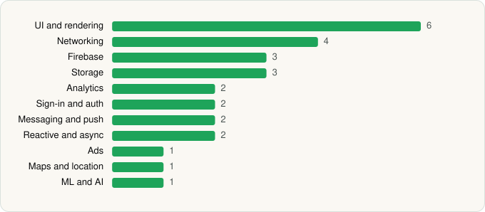

<picture><source media="(prefers-color-scheme: dark)" srcset="../../../../assets/logo/logo-dark.svg"></picture> [Tech Stack](../../../../README.md) / [NAVER Corp.](../../../../companies/naver-corp.md) / 네이버플러스 스토어

# 네이버플러스 스토어

<picture><source media="(prefers-color-scheme: dark)" srcset="../../../../assets/badges/android-dark.svg"></picture> <picture><source media="(prefers-color-scheme: dark)" srcset="../../../../assets/badges/active-dark.svg"></picture>

[Google Play](https://play.google.com/store/apps/details?id=com.navercorp.navershopping) · [latest.json](latest.json)

| | |
|---|---|
| Company | [NAVER Corp.](../../../../companies/naver-corp.md) |
| Store id | `com.navercorp.navershopping` |
| Bundle / package id | `com.navercorp.navershopping` |
| Latest version | 2.9.10 (analysed 2026-11-05) |
| Versions tracked | 1 |
| SDKs in latest version | 27 |
| Languages | C/C++ (native), Java, Kotlin |
| UI | Coil, Glide, Jetpack Compose, Lottie, Material Components, Picasso |
| Build | Gradle (inferred) |
| Minimum OS | API 28, targets API 36 |
| Devices / ABIs | Android |
| Capabilities | 12 |
| Declares tracking | Yes |
| Tracked | Yes |

## SDKs by category

<picture><source media="(prefers-color-scheme: dark)" srcset="../../../../assets/charts/apps/android/naver-corp/app-dark.svg"></picture>

- **UI and rendering** (6): Coil, Glide, Jetpack Compose, Lottie, Material Components, Picasso
- **Networking** (4): Cronet, Cronet (Google), OkHttp, Retrofit
- **Firebase** (3): Firebase, Google DataTransport, Google Play services
- **Storage** (3): DataStore, Okio, Room
- **Analytics** (2): AppsFlyer, Firebase Analytics
- **Sign-in and auth** (2): Credential Manager, Google Sign-In / Auth
- **Messaging and push** (2): Braze, Firebase Messaging
- **Reactive and async** (2): Kotlin Coroutines, RxJava
- **Ads** (1): Google Mobile Ads (AdMob)
- **Maps and location** (1): Google Location
- **ML and AI** (1): OpenCV

Capabilities (12)

Advertising ID, Approximate location, Biometric auth, Camera, Contacts (read), Draw over other apps, Fingerprint auth, Foreground service, Notifications, Precise location, Storage (read), Storage (write)

## Version history

| Version | Analysed | Store update | SDKs | Change | SDK list is a floor | Binary encrypted | File |
|---|---|---|---|---|---|---|---|
| 2.9.10 | 2026-11-05 | 2026-10-29 | 27 |  | No | No | [2.9.10.json](2.9.10.json) |

---

Generated by `scripts/build_readme.py` from the JSON files. Do not edit by hand.
