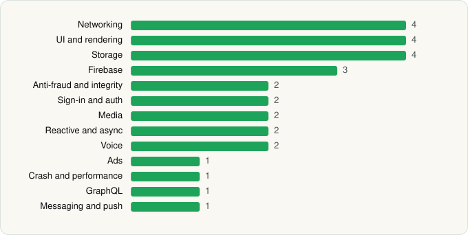

<picture><source media="(prefers-color-scheme: dark)" srcset="../../../../assets/logo/logo-dark.svg"></picture> [Tech Stack](../../../../README.md) / [Netflix, Inc.](../../../../companies/netflix-inc.md) / Netflix

# Netflix

<picture><source media="(prefers-color-scheme: dark)" srcset="../../../../assets/badges/android-dark.svg"></picture> <picture><source media="(prefers-color-scheme: dark)" srcset="../../../../assets/badges/active-dark.svg"></picture>

[Google Play](https://play.google.com/store/apps/details?id=com.netflix.mediaclient) · [latest.json](latest.json)

| | |
|---|---|
| Company | [Netflix, Inc.](../../../../companies/netflix-inc.md) |
| Store id | `com.netflix.mediaclient` |
| Bundle / package id | `com.netflix.mediaclient` |
| Latest version | 9.65.0 build 9 64253 (analysed 2026-06-19) |
| Versions tracked | 1 |
| SDKs in latest version | 29 |
| Languages | C/C++ (native), Java, Kotlin |
| UI | Coil, Jetpack Compose, Lottie, Material Components |
| Build | Gradle (inferred) |
| Minimum OS | API 28, targets API 36 |
| Devices / ABIs | Android |
| Capabilities | 9 |
| Declares tracking | Yes |
| Tracked | Yes |

## SDKs by category

<picture><source media="(prefers-color-scheme: dark)" srcset="../../../../assets/charts/apps/android/netflix-inc/netflix-dark.svg"></picture>

- **Networking** (4): Cronet, Cronet (Chromium net), Cronet (Google), OkHttp
- **UI and rendering** (4): Coil, Jetpack Compose, Lottie, Material Components
- **Storage** (4): DataStore, Okio, Room, SQLDelight
- **Firebase** (3): Firebase, Google DataTransport, Google Play services
- **Anti-fraud and integrity** (2): Play Integrity, reCAPTCHA
- **Sign-in and auth** (2): Credential Manager, Google Sign-In / Auth
- **Media** (2): Google Cast, Media3 (ExoPlayer)
- **Reactive and async** (2): Kotlin Coroutines, RxJava
- **Voice** (2): Agora, Twilio
- **Ads** (1): Google Mobile Ads (AdMob)
- **Crash and performance** (1): Bugsnag
- **GraphQL** (1): Apollo GraphQL
- **Messaging and push** (1): Firebase Messaging

Capabilities (9)

Advertising ID, Bluetooth, Camera, Foreground service, Foreground service: media playback, Foreground service: microphone, Microphone, Notifications, Storage (write)

## Version history

| Version | Analysed | Store update | SDKs | Change | SDK list is a floor | Binary encrypted | File |
|---|---|---|---|---|---|---|---|
| 9.65.0 build 9 64253 | 2026-06-19 |  | 29 |  | No | No | [9.65.0_build_9_64253.json](9.65.0_build_9_64253.json) |

---

Generated by `scripts/build_readme.py` from the JSON files. Do not edit by hand.
