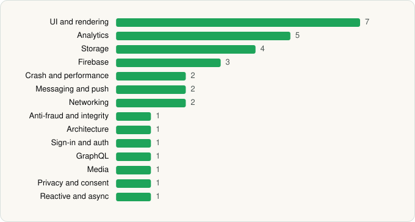

<picture><source media="(prefers-color-scheme: dark)" srcset="../../../../assets/logo/logo-dark.svg"></picture> [Tech Stack](../../../../README.md) / [Ønskeskyen ApS](../../../../companies/nskeskyen-aps.md) / GoWish

# GoWish - Your Digital Wishlist

<picture><source media="(prefers-color-scheme: dark)" srcset="../../../../assets/badges/android-dark.svg"></picture> <picture><source media="(prefers-color-scheme: dark)" srcset="../../../../assets/badges/inactive-dark.svg"></picture> <picture><source media="(prefers-color-scheme: dark)" srcset="../../../../assets/badges/floor-dark.svg"></picture>

[Google Play](https://play.google.com/store/apps/details?id=com.gowish.app) · [latest.json](latest.json)

| | |
|---|---|
| Company | [Ønskeskyen ApS](../../../../companies/nskeskyen-aps.md) |
| Store id | `com.gowish.app` |
| Bundle / package id | `com.gowish.app` |
| Latest version | 9.2.7 (analysed 2026-11-09) |
| Versions tracked | 1 |
| SDKs in latest version | 32 |
| Languages | C/C++ (native), Java, Kotlin, React Native / JavaScript |
| UI | Coil, Fresco, Glide, Jetpack Compose, Material Components |
| Build | Gradle (inferred), R8 / ProGuard (name obfuscation detected) |
| Minimum OS | API 24, targets API 36 |
| Devices / ABIs | Android |
| Capabilities | 10 |
| Declares tracking | Yes |
| Tracked | No. Kept for history. |

## SDKs by category

<picture><source media="(prefers-color-scheme: dark)" srcset="../../../../assets/charts/apps/android/nskeskyen-aps/gowish-dark.svg"></picture>

- **UI and rendering** (7): Coil, Fresco, Glide, Jetpack Compose, Material Components, React Native Reanimated, react-native-svg
- **Analytics** (5): Amplitude, AppsFlyer, Branch, Firebase Analytics, Google App Measurement
- **Storage** (4): DataStore, Okio, Realm, Room
- **Firebase** (3): Firebase, Google DataTransport, Google Play services
- **Crash and performance** (2): Sentry, Sentry (native)
- **Messaging and push** (2): Firebase Messaging, Intercom
- **Networking** (2): OkHttp, Retrofit
- **Anti-fraud and integrity** (1): Play Integrity
- **Architecture** (1): Redux
- **Sign-in and auth** (1): Google Sign-In / Auth
- **GraphQL** (1): Apollo GraphQL
- **Media** (1): Media3 (ExoPlayer)
- **Privacy and consent** (1): Usercentrics
- **Reactive and async** (1): Kotlin Coroutines

Capabilities (10)

Advertising ID, Approximate location, Biometric auth, Contacts (read), Contacts (write), Draw over other apps, Fingerprint auth, Foreground service, Notifications, Storage (write)

## Version history

| Version | Analysed | Store update | SDKs | Change | SDK list is a floor | Binary encrypted | File |
|---|---|---|---|---|---|---|---|
| 9.2.7 | 2026-11-09 |  | 32 |  | Yes | No | [9.2.7.json](9.2.7.json) |

---

Generated by `scripts/build_readme.py` from the JSON files. Do not edit by hand.
