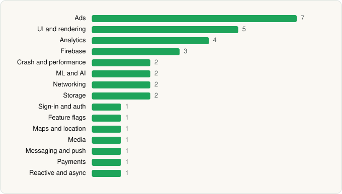

<picture><source media="(prefers-color-scheme: dark)" srcset="../../../../assets/logo/logo-dark.svg"></picture> [Tech Stack](../../../../README.md) / [Office Suite Pro](../../../../companies/office-suite-pro.md) / PDF ProX

# PDF ProX: PDF Reader & Editor

<picture><source media="(prefers-color-scheme: dark)" srcset="../../../../assets/badges/android-dark.svg"></picture> <picture><source media="(prefers-color-scheme: dark)" srcset="../../../../assets/badges/inactive-dark.svg"></picture>

[Google Play](https://play.google.com/store/apps/details?id=com.trusted.pdfeditor.pdfreader) · [latest.json](latest.json)

| | |
|---|---|
| Company | [Office Suite Pro](../../../../companies/office-suite-pro.md) |
| Store id | `com.trusted.pdfeditor.pdfreader` |
| Bundle / package id | `com.trusted.pdfeditor.pdfreader` |
| Latest version | 2.0.2-Office (analysed 2026-11-06) |
| Versions tracked | 1 |
| SDKs in latest version | 34 |
| Languages | C/C++ (native), Java, Kotlin, Unity (C# / IL2CPP) |
| UI | Glide, Lottie, Material Components, Picasso |
| Build | Gradle (inferred) |
| Minimum OS | API 26, targets API 36 |
| Devices / ABIs | Android |
| Capabilities | 7 |
| Declares tracking | Yes |
| Tracked | No. Kept for history. |

## SDKs by category

<picture><source media="(prefers-color-scheme: dark)" srcset="../../../../assets/charts/apps/android/office-suite-pro/pdf-prox-dark.svg"></picture>

- **Ads** (7): AppLovin, Fyber, Google Mobile Ads (AdMob), ironSource, Meta Audience Network, Mintegral, Pangle
- **UI and rendering** (5): Glide, Lottie, Markwon, Material Components, Picasso
- **Analytics** (4): Adjust, Facebook SDK, Firebase Analytics, Google App Measurement
- **Firebase** (3): Firebase, Google DataTransport, Google Play services
- **Crash and performance** (2): Firebase Crashlytics, Firebase Performance
- **ML and AI** (2): ML Kit, OpenCV
- **Networking** (2): OkHttp, Retrofit
- **Storage** (2): DataStore, Room
- **Sign-in and auth** (1): Google Sign-In / Auth
- **Feature flags** (1): Firebase Remote Config
- **Maps and location** (1): Google Location
- **Media** (1): Media3 (ExoPlayer)
- **Messaging and push** (1): Firebase Messaging
- **Payments** (1): Google Play Billing
- **Reactive and async** (1): Kotlin Coroutines

Capabilities (7)

Advertising ID, All-files storage access, Camera, Foreground service, Notifications, Storage (read), Storage (write)

## Version history

| Version | Analysed | Store update | SDKs | Change | SDK list is a floor | Binary encrypted | File |
|---|---|---|---|---|---|---|---|
| 2.0.2-Office | 2026-11-06 | 2026-10-08 | 34 |  | No | No | [2.0.2-Office.json](2.0.2-Office.json) |

---

Generated by `scripts/build_readme.py` from the JSON files. Do not edit by hand.
