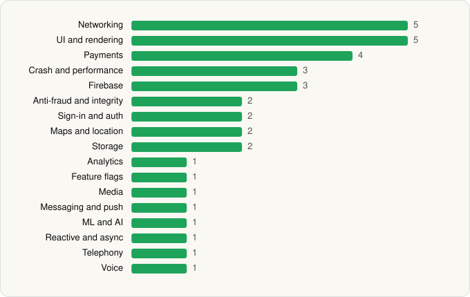

<picture><source media="(prefers-color-scheme: dark)" srcset="../../../../assets/logo/logo-dark.svg"></picture> [Tech Stack](../../../../README.md) / [OpenAI](../../../../companies/openai.md) / ChatGPT

# ChatGPT

<picture><source media="(prefers-color-scheme: dark)" srcset="../../../../assets/badges/android-dark.svg"></picture> <picture><source media="(prefers-color-scheme: dark)" srcset="../../../../assets/badges/active-dark.svg"></picture>

[Google Play](https://play.google.com/store/apps/details?id=com.openai.chatgpt) · [latest.json](latest.json)

| | |
|---|---|
| Company | [OpenAI](../../../../companies/openai.md) |
| Store id | `com.openai.chatgpt` |
| Bundle / package id | `com.openai.chatgpt` |
| Latest version | 1.2026.286 (analysed 2026-10-23) |
| Versions tracked | 1 |
| SDKs in latest version | 36 |
| Languages | C/C++ (native), Java, Kotlin |
| UI | Coil, Jetpack Compose, Lottie, Material Components |
| Build | Gradle (inferred) |
| Minimum OS | API 32, targets API 37 |
| Devices / ABIs | Android |
| Capabilities | 18 |
| Declares tracking | Yes |
| Tracked | Yes |

## SDKs by category

<picture><source media="(prefers-color-scheme: dark)" srcset="../../../../assets/charts/apps/android/openai/chatgpt-dark.svg"></picture>

- **Networking** (5): Cronet, Cronet (Google), Ktor, OkHttp, Retrofit
- **UI and rendering** (5): AndroidSVG, Coil, Jetpack Compose, Lottie, Material Components
- **Payments** (4): Google Play Billing, Plaid, RevenueCat, Stripe
- **Crash and performance** (3): Datadog, Sentry, Sentry (native)
- **Firebase** (3): Firebase, Google DataTransport, Google Play services
- **Anti-fraud and integrity** (2): Persona, Play Integrity
- **Sign-in and auth** (2): Credential Manager, Google Sign-In / Auth
- **Maps and location** (2): Google Location, Google Maps
- **Storage** (2): DataStore, Room
- **Analytics** (1): Segment
- **Feature flags** (1): Statsig
- **Media** (1): Media3 (ExoPlayer)
- **Messaging and push** (1): Firebase Messaging
- **ML and AI** (1): ML Kit
- **Reactive and async** (1): Kotlin Coroutines
- **Telephony** (1): libphonenumber
- **Voice** (1): WebRTC

Capabilities (18)

Advertising ID, Approximate location, Biometric auth, Bluetooth, Bluetooth (connect), Calendar (read), Calendar (write), Camera, Contacts (read), Fingerprint auth, Foreground service, Foreground service: microphone, Microphone, NFC, Notifications, Phone / carrier info, Precise location, SMS (send)

## Version history

| Version | Analysed | Store update | SDKs | Change | SDK list is a floor | Binary encrypted | File |
|---|---|---|---|---|---|---|---|
| 1.2026.286 | 2026-10-23 | 2026-10-17 | 36 |  | No | No | [1.2026.286.json](1.2026.286.json) |

---

Generated by `scripts/build_readme.py` from the JSON files. Do not edit by hand.
