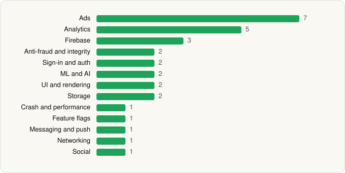

<picture><source media="(prefers-color-scheme: dark)" srcset="../../../../assets/logo/logo-dark.svg"></picture> [Tech Stack](../../../../README.md) / [P & L Studio](../../../../companies/p-l-studio.md) / QR Scanner

# QR Scanner

<picture><source media="(prefers-color-scheme: dark)" srcset="../../../../assets/badges/android-dark.svg"></picture> <picture><source media="(prefers-color-scheme: dark)" srcset="../../../../assets/badges/inactive-dark.svg"></picture>

[Google Play](https://play.google.com/store/apps/details?id=com.scannerreader.qrcode.creatorfree) · [latest.json](latest.json)

| | |
|---|---|
| Company | [P & L Studio](../../../../companies/p-l-studio.md) |
| Store id | `com.scannerreader.qrcode.creatorfree` |
| Bundle / package id | `com.scannerreader.qrcode.creatorfree` |
| Latest version | 1.8.3 (analysed 2026-11-09) |
| Versions tracked | 1 |
| SDKs in latest version | 30 |
| Languages | C/C++ (native), Java, Kotlin |
| UI | Glide, Material Components |
| Build | Gradle (inferred) |
| Minimum OS | API 24, targets API 35 |
| Devices / ABIs | Android |
| Capabilities | 7 |
| Declares tracking | Yes |
| Tracked | No. Kept for history. |

## SDKs by category

<picture><source media="(prefers-color-scheme: dark)" srcset="../../../../assets/charts/apps/android/p-l-studio/qr-scanner-dark.svg"></picture>

- **Ads** (7): AppLovin, Google Ad Manager, Google Mobile Ads (AdMob), Meta Audience Network, Mintegral, Pangle, Vungle
- **Analytics** (5): Adjust, AppsFlyer, Facebook SDK, Firebase Analytics, Google App Measurement
- **Firebase** (3): Firebase, Google DataTransport, Google Play services
- **Anti-fraud and integrity** (2): Play Integrity, RootBeer
- **Sign-in and auth** (2): Facebook Login, Google Sign-In / Auth
- **ML and AI** (2): ML Kit, ML Kit (barcode/vision)
- **UI and rendering** (2): Glide, Material Components
- **Storage** (2): DataStore, Room
- **Crash and performance** (1): Firebase Crashlytics
- **Feature flags** (1): Firebase Remote Config
- **Messaging and push** (1): Firebase Messaging
- **Networking** (1): OkHttp
- **Social** (1): Facebook Share

Capabilities (7)

Advertising ID, Camera, Contacts (read), Foreground service, Notifications, Storage (read), Storage (write)

## Version history

| Version | Analysed | Store update | SDKs | Change | SDK list is a floor | Binary encrypted | File |
|---|---|---|---|---|---|---|---|
| 1.8.3 | 2026-11-09 |  | 30 |  | No | No | [1.8.3.json](1.8.3.json) |

---

Generated by `scripts/build_readme.py` from the JSON files. Do not edit by hand.
