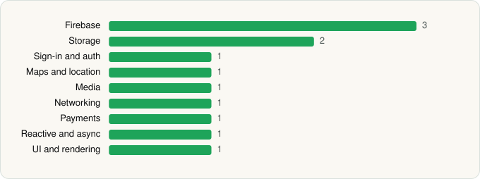

<picture><source media="(prefers-color-scheme: dark)" srcset="../../../../assets/logo/logo-dark.svg"></picture> [Tech Stack](../../../../README.md) / [Pandora](../../../../companies/pandora.md) / Pandora Music for TV

# Pandora Music for TV

<picture><source media="(prefers-color-scheme: dark)" srcset="../../../../assets/badges/android-dark.svg"></picture> <picture><source media="(prefers-color-scheme: dark)" srcset="../../../../assets/badges/inactive-dark.svg"></picture>

[Google Play](https://play.google.com/store/apps/details?id=com.pandora.android.atv) · [latest.json](latest.json)

| | |
|---|---|
| Company | [Pandora](../../../../companies/pandora.md) |
| Store id | `com.pandora.android.atv` |
| Bundle / package id | `com.pandora.android.atv` |
| Latest version | 4.3.1 (analysed 2026-06-19) |
| Versions tracked | 1 |
| SDKs in latest version | 12 |
| Languages | Java, Kotlin |
| UI | Glide |
| Build | Gradle (inferred) |
| Minimum OS | API 24, targets API 35 |
| Devices / ABIs | Android |
| Capabilities | 3 |
| Declares tracking | No |
| Tracked | No. Kept for history. |

## SDKs by category

<picture><source media="(prefers-color-scheme: dark)" srcset="../../../../assets/charts/apps/android/pandora/pandora-music-for-tv-dark.svg"></picture>

- **Firebase** (3): Firebase, Google DataTransport, Google Play services
- **Storage** (2): Okio, Room
- **Sign-in and auth** (1): Google Sign-In / Auth
- **Maps and location** (1): Google Location
- **Media** (1): ExoPlayer
- **Networking** (1): OkHttp
- **Payments** (1): Google Play Billing
- **Reactive and async** (1): Kotlin Coroutines
- **UI and rendering** (1): Glide

Capabilities (3)

Foreground service, Foreground service: media playback, Microphone

## Version history

| Version | Analysed | Store update | SDKs | Change | SDK list is a floor | Binary encrypted | File |
|---|---|---|---|---|---|---|---|
| 4.3.1 | 2026-06-19 |  | 12 |  | No | No | [4.3.1.json](4.3.1.json) |

---

Generated by `scripts/build_readme.py` from the JSON files. Do not edit by hand.
