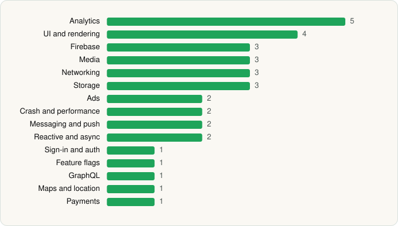

<picture><source media="(prefers-color-scheme: dark)" srcset="../../../../assets/logo/logo-dark.svg"></picture> [Tech Stack](../../../../README.md) / [Pandora](../../../../companies/pandora.md) / Pandora

# Pandora - Music & Podcasts

<picture><source media="(prefers-color-scheme: dark)" srcset="../../../../assets/badges/android-dark.svg"></picture> <picture><source media="(prefers-color-scheme: dark)" srcset="../../../../assets/badges/inactive-dark.svg"></picture> <picture><source media="(prefers-color-scheme: dark)" srcset="../../../../assets/badges/floor-dark.svg"></picture>

[Google Play](https://play.google.com/store/apps/details?id=com.pandora.android) · [latest.json](latest.json)

| | |
|---|---|
| Company | [Pandora](../../../../companies/pandora.md) |
| Store id | `com.pandora.android` |
| Bundle / package id | `com.pandora.android` |
| Latest version | 2606.1 (analysed 2026-06-19) |
| Versions tracked | 1 |
| SDKs in latest version | 34 |
| Languages | C/C++ (native), Java, Kotlin |
| UI | Coil, Glide, Jetpack Compose, Material Components |
| Build | Gradle (inferred), R8 / ProGuard (name obfuscation detected) |
| Minimum OS | API 24, targets API 35 |
| Devices / ABIs | Android |
| Capabilities | 9 |
| Declares tracking | Yes |
| Tracked | No. Kept for history. |

## SDKs by category

<picture><source media="(prefers-color-scheme: dark)" srcset="../../../../assets/charts/apps/android/pandora/pandora-dark.svg"></picture>

- **Analytics** (5): Adobe Experience Platform, Branch, comScore, Firebase Analytics, Google App Measurement
- **UI and rendering** (4): Coil, Glide, Jetpack Compose, Material Components
- **Firebase** (3): Firebase, Google DataTransport, Google Play services
- **Media** (3): ExoPlayer, Google Cast, Media3 (ExoPlayer)
- **Networking** (3): Ktor, OkHttp, Retrofit
- **Storage** (3): DataStore, Room, SQLDelight
- **Ads** (2): Google Ad Manager, Google Mobile Ads (AdMob)
- **Crash and performance** (2): Datadog, Firebase Performance
- **Messaging and push** (2): Airship, Firebase Messaging
- **Reactive and async** (2): Kotlin Coroutines, RxJava
- **Sign-in and auth** (1): Google Sign-In / Auth
- **Feature flags** (1): Firebase Remote Config
- **GraphQL** (1): Apollo GraphQL
- **Maps and location** (1): Google Location
- **Payments** (1): Google Play Billing

Capabilities (9)

Advertising ID, Bluetooth, Bluetooth (connect), Foreground service, Foreground service: media playback, Notifications, Phone / carrier info, Storage (read), Storage (write)

## Version history

| Version | Analysed | Store update | SDKs | Change | SDK list is a floor | Binary encrypted | File |
|---|---|---|---|---|---|---|---|
| 2606.1 | 2026-06-19 |  | 34 |  | Yes | No | [2606.1.json](2606.1.json) |

---

Generated by `scripts/build_readme.py` from the JSON files. Do not edit by hand.
