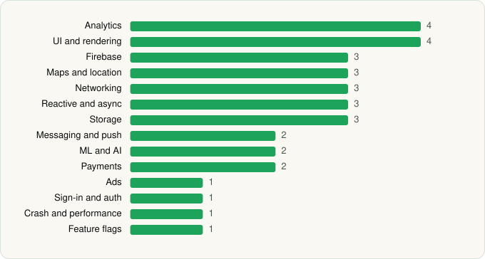

<picture><source media="(prefers-color-scheme: dark)" srcset="../../../../assets/logo/logo-dark.svg"></picture> [Tech Stack](../../../../README.md) / [Panera Bread](../../../../companies/panera-bread.md) / Panera Bread

# Panera Bread

<picture><source media="(prefers-color-scheme: dark)" srcset="../../../../assets/badges/android-dark.svg"></picture> <picture><source media="(prefers-color-scheme: dark)" srcset="../../../../assets/badges/inactive-dark.svg"></picture> <picture><source media="(prefers-color-scheme: dark)" srcset="../../../../assets/badges/floor-dark.svg"></picture>

[Google Play](https://play.google.com/store/apps/details?id=com.panera.bread) · [latest.json](latest.json)

| | |
|---|---|
| Company | [Panera Bread](../../../../companies/panera-bread.md) |
| Store id | `com.panera.bread` |
| Bundle / package id | `com.panera.bread` |
| Latest version | 6.6.1 (analysed 2026-06-25) |
| Versions tracked | 1 |
| SDKs in latest version | 33 |
| Languages | C/C++ (native), Java, Kotlin |
| UI | Coil, Jetpack Compose, Material Components |
| Build | Gradle (inferred), R8 / ProGuard (name obfuscation detected) |
| Minimum OS | API 26, targets API 35 |
| Devices / ABIs | Android |
| Capabilities | 10 |
| Declares tracking | Yes |
| Tracked | No. Kept for history. |

## SDKs by category

<picture><source media="(prefers-color-scheme: dark)" srcset="../../../../assets/charts/apps/android/panera-bread/panera-bread-dark.svg"></picture>

- **Analytics** (4): Adobe Experience Platform, AppsFlyer, Firebase Analytics, Google App Measurement
- **UI and rendering** (4): AndroidSVG, Coil, Jetpack Compose, Material Components
- **Firebase** (3): Firebase, Google DataTransport, Google Play services
- **Maps and location** (3): Google Location, Google Maps, Mapbox
- **Networking** (3): OkHttp, Retrofit, Volley
- **Reactive and async** (3): Kotlin Coroutines, RxJava, RxJava 3
- **Storage** (3): DataStore, Okio, Room
- **Messaging and push** (2): Braze, Firebase Messaging
- **ML and AI** (2): TensorFlow, TensorFlow Lite
- **Payments** (2): Braintree, Stripe
- **Ads** (1): Google Mobile Ads (AdMob)
- **Sign-in and auth** (1): Google Sign-In / Auth
- **Crash and performance** (1): Firebase Crashlytics
- **Feature flags** (1): Firebase Remote Config

Capabilities (10)

Approximate location, Background location, Bluetooth (connect), Camera, Foreground service, Microphone, Notifications, Phone / carrier info, Precise location, Storage (read)

## Version history

| Version | Analysed | Store update | SDKs | Change | SDK list is a floor | Binary encrypted | File |
|---|---|---|---|---|---|---|---|
| 6.6.1 | 2026-06-25 |  | 33 |  | Yes | No | [6.6.1.json](6.6.1.json) |

## Model-written summary

> Obfuscated Kotlin/Java Android app with Jetpack Compose, Mapbox GL, TensorFlow Lite model, Firebase, Braintree and Stripe

Written by a language model from the detected signals (`inferred[]`). It is commentary, not measurement.

---

Generated by `scripts/build_readme.py` from the JSON files. Do not edit by hand.
