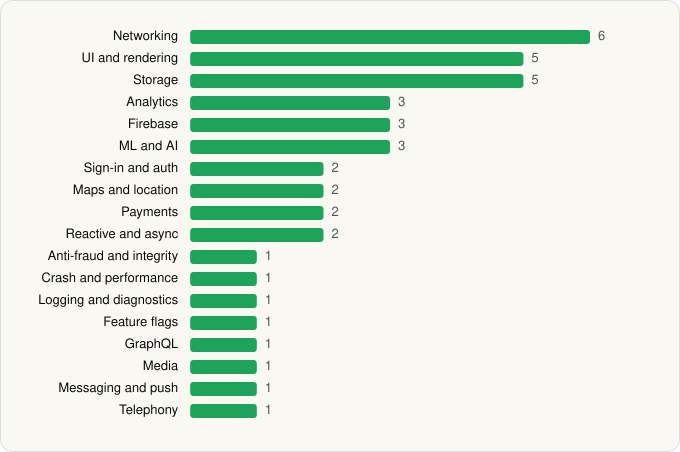

<picture><source media="(prefers-color-scheme: dark)" srcset="../../../../assets/logo/logo-dark.svg"></picture> [Tech Stack](../../../../README.md) / [PayPal Mobile](../../../../companies/paypal-mobile.md) / PayPal

# PayPal - Pay, Send, Save

<picture><source media="(prefers-color-scheme: dark)" srcset="../../../../assets/badges/android-dark.svg"></picture> <picture><source media="(prefers-color-scheme: dark)" srcset="../../../../assets/badges/inactive-dark.svg"></picture>

[Google Play](https://play.google.com/store/apps/details?id=com.paypal.android.p2pmobile) · [latest.json](latest.json)

| | |
|---|---|
| Company | [PayPal Mobile](../../../../companies/paypal-mobile.md) |
| Store id | `com.paypal.android.p2pmobile` |
| Bundle / package id | `com.paypal.android.p2pmobile` |
| Latest version | 9.1.0 (analysed 2026-06-19) |
| Versions tracked | 1 |
| SDKs in latest version | 41 |
| Languages | C/C++ (native), Java, Kotlin |
| UI | Coil, Jetpack Compose, Lottie, Material Components |
| Build | Gradle (inferred) |
| Minimum OS | API 26, targets API 36 |
| Devices / ABIs | Android |
| Capabilities | 12 |
| Declares tracking | Yes |
| Tracked | No. Kept for history. |

## SDKs by category

<picture><source media="(prefers-color-scheme: dark)" srcset="../../../../assets/charts/apps/android/paypal-mobile/paypal-dark.svg"></picture>

- **Networking** (6): Cronet, Cronet (Google), Ktor, OkHttp, Retrofit, Volley
- **UI and rendering** (5): AndroidSVG, Coil, Jetpack Compose, Lottie, Material Components
- **Storage** (5): DataStore, Okio, Room, SQLCipher, SQLDelight
- **Analytics** (3): Adjust, Adobe Experience Platform, Firebase Analytics
- **Firebase** (3): Firebase, Google DataTransport, Google Play services
- **ML and AI** (3): ML Kit, TensorFlow, TensorFlow Lite
- **Sign-in and auth** (2): Credential Manager, Google Sign-In / Auth
- **Maps and location** (2): Google Location, Google Maps
- **Payments** (2): PayPal, Plaid
- **Reactive and async** (2): Kotlin Coroutines, RxJava
- **Anti-fraud and integrity** (1): Play Integrity
- **Crash and performance** (1): Datadog
- **Logging and diagnostics** (1): Chucker
- **Feature flags** (1): Statsig
- **GraphQL** (1): Apollo GraphQL
- **Media** (1): Media3 (ExoPlayer)
- **Messaging and push** (1): Firebase Messaging
- **Telephony** (1): libphonenumber

Capabilities (12)

Advertising ID, Approximate location, Biometric auth, Bluetooth, Bluetooth (connect), Bluetooth (scan), Camera, Foreground service, Microphone, NFC, Notifications, Precise location

## Version history

| Version | Analysed | Store update | SDKs | Change | SDK list is a floor | Binary encrypted | File |
|---|---|---|---|---|---|---|---|
| 9.1.0 | 2026-06-19 |  | 41 |  | No | No | [9.1.0.json](9.1.0.json) |

## Model-written summary

> Kotlin/Java Android PayPal app with Jetpack Compose, 38 native libraries including BlinkID and TFLite, Firebase, and first-party PayPal APIs

Written by a language model from the detected signals (`inferred[]`). It is commentary, not measurement.

---

Generated by `scripts/build_readme.py` from the JSON files. Do not edit by hand.
