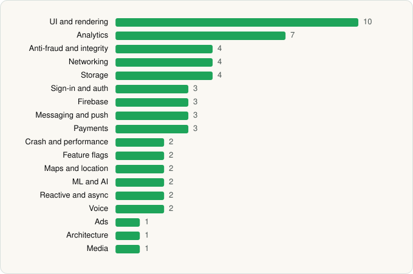

<picture><source media="(prefers-color-scheme: dark)" srcset="../../../../assets/logo/logo-dark.svg"></picture> [Tech Stack](../../../../README.md) / [Payward, Inc.](../../../../companies/payward-inc.md) / Kraken

# Kraken: Buy Crypto & Stocks

<picture><source media="(prefers-color-scheme: dark)" srcset="../../../../assets/badges/android-dark.svg"></picture> <picture><source media="(prefers-color-scheme: dark)" srcset="../../../../assets/badges/inactive-dark.svg"></picture> <picture><source media="(prefers-color-scheme: dark)" srcset="../../../../assets/badges/floor-dark.svg"></picture>

[Google Play](https://play.google.com/store/apps/details?id=com.kraken.invest.app) · [latest.json](latest.json)

| | |
|---|---|
| Company | [Payward, Inc.](../../../../companies/payward-inc.md) |
| Store id | `com.kraken.invest.app` |
| Bundle / package id | `com.kraken.invest.app` |
| Latest version | 3.67.7 (analysed 2026-06-19) |
| Versions tracked | 1 |
| SDKs in latest version | 56 |
| Languages | C/C++ (native), Java, Kotlin, React Native / JavaScript |
| UI | Coil, Fresco, Glide, Jetpack Compose, Lottie, Material Components |
| Build | Gradle (inferred), R8 / ProGuard (name obfuscation detected) |
| Minimum OS | API 26, targets API 36 |
| Devices / ABIs | Android |
| Capabilities | 16 |
| Declares tracking | Yes |
| Tracked | No. Kept for history. |

## SDKs by category

<picture><source media="(prefers-color-scheme: dark)" srcset="../../../../assets/charts/apps/android/payward-inc/kraken-dark.svg"></picture>

- **UI and rendering** (10): AndroidSVG, Coil, FlashList, Fresco, Glide, Jetpack Compose, Lottie, Material Components, React Native Reanimated, react-native-svg
- **Analytics** (7): Amplitude, AppsFlyer, Branch, Firebase Analytics, FullStory, Google App Measurement, Segment
- **Anti-fraud and integrity** (4): Fingerprint, Persona, Play Integrity, RootBeer
- **Networking** (4): OkHttp, Retrofit, TanStack Query, Volley
- **Storage** (4): DataStore, Okio, Realm, Room
- **Sign-in and auth** (3): Auth0, Credential Manager, Google Sign-In / Auth
- **Firebase** (3): Firebase, Google DataTransport, Google Play services
- **Messaging and push** (3): Braze, Firebase Messaging, Zendesk
- **Payments** (3): Braintree, Google Play Billing, Plaid
- **Crash and performance** (2): Sentry, Sentry (native)
- **Feature flags** (2): LaunchDarkly, Statsig
- **Maps and location** (2): Google Location, Google Maps
- **ML and AI** (2): ML Kit, ML Kit (barcode/vision)
- **Reactive and async** (2): Kotlin Coroutines, RxJS
- **Voice** (2): Twilio, WebRTC
- **Ads** (1): Google Mobile Ads (AdMob)
- **Architecture** (1): Redux
- **Media** (1): Media3 (ExoPlayer)

Capabilities (16)

Advertising ID, Approximate location, Biometric auth, Bluetooth, Bluetooth (connect), Camera, Fingerprint auth, Foreground service, Foreground service: microphone, Microphone, NFC, Notifications, Phone / carrier info, Precise location, Storage (read), Storage (write)

## Version history

| Version | Analysed | Store update | SDKs | Change | SDK list is a floor | Binary encrypted | File |
|---|---|---|---|---|---|---|---|
| 3.67.7 | 2026-06-19 |  | 56 |  | Yes | No | [3.67.7.json](3.67.7.json) |

## Model-written summary

> React Native (Hermes) Android crypto app with custom Nitro native modules, Jetpack Compose, ML Kit vision models, and Kraken backends

Written by a language model from the detected signals (`inferred[]`). It is commentary, not measurement.

---

Generated by `scripts/build_readme.py` from the JSON files. Do not edit by hand.
