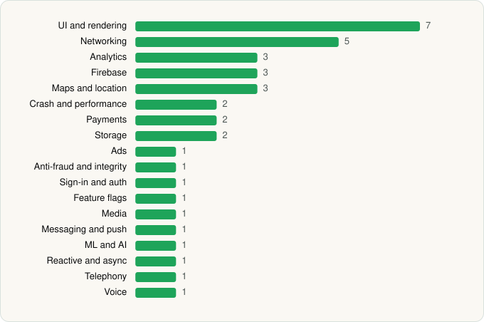

<picture><source media="(prefers-color-scheme: dark)" srcset="../../../../assets/logo/logo-dark.svg"></picture> [Tech Stack](../../../../README.md) / [PerplexityAI](../../../../companies/perplexityai.md) / Perplexity

# Perplexity - AI Search & Chat

<picture><source media="(prefers-color-scheme: dark)" srcset="../../../../assets/badges/android-dark.svg"></picture> <picture><source media="(prefers-color-scheme: dark)" srcset="../../../../assets/badges/active-dark.svg"></picture>

[Google Play](https://play.google.com/store/apps/details?id=ai.perplexity.app.android) · [latest.json](latest.json)

| | |
|---|---|
| Company | [PerplexityAI](../../../../companies/perplexityai.md) |
| Store id | `ai.perplexity.app.android` |
| Bundle / package id | `ai.perplexity.app.android` |
| Latest version | 2.101.0 (analysed 2026-10-24) |
| Versions tracked | 1 |
| SDKs in latest version | 37 |
| Languages | C/C++ (native), Java, Kotlin |
| UI | Coil, Glide, Jetpack Compose, Material Components |
| Build | Gradle (inferred) |
| Minimum OS | API 32, targets API 37 |
| Devices / ABIs | Android |
| Capabilities | 18 |
| Declares tracking | Yes |
| Tracked | Yes |

## SDKs by category

<picture><source media="(prefers-color-scheme: dark)" srcset="../../../../assets/charts/apps/android/perplexityai/perplexity-dark.svg"></picture>

- **UI and rendering** (7): AndroidSVG, Coil, Glide, Jetpack Compose, jLaTeXMath, Markwon, Material Components
- **Networking** (5): Cronet, Cronet (Google), OkHttp, Retrofit, Volley
- **Analytics** (3): Firebase Analytics, Google App Measurement, Singular
- **Firebase** (3): Firebase, Google DataTransport, Google Play services
- **Maps and location** (3): Google Location, Google Maps, Mapbox
- **Crash and performance** (2): Firebase Crashlytics, Firebase Performance
- **Payments** (2): Google Play Billing, RevenueCat
- **Storage** (2): DataStore, Room
- **Ads** (1): Google Mobile Ads (AdMob)
- **Anti-fraud and integrity** (1): Play Integrity
- **Sign-in and auth** (1): Google Sign-In / Auth
- **Feature flags** (1): Firebase Remote Config
- **Media** (1): Media3 (ExoPlayer)
- **Messaging and push** (1): Firebase Messaging
- **ML and AI** (1): ONNX Runtime
- **Reactive and async** (1): Kotlin Coroutines
- **Telephony** (1): libphonenumber
- **Voice** (1): WebRTC

Capabilities (18)

Advertising ID, Approximate location, Bluetooth (connect), Calendar (read), Calendar (write), Camera, Contacts (read), Foreground service, Foreground service: media playback, Foreground service: microphone, Microphone, Notifications, Precise location, Query all installed apps, SMS (read), SMS (send), Storage (read), Storage (write)

## Version history

| Version | Analysed | Store update | SDKs | Change | SDK list is a floor | Binary encrypted | File |
|---|---|---|---|---|---|---|---|
| 2.101.0 | 2026-10-24 | 2026-10-12 | 37 |  | No | No | [2.101.0.json](2.101.0.json) |

---

Generated by `scripts/build_readme.py` from the JSON files. Do not edit by hand.
