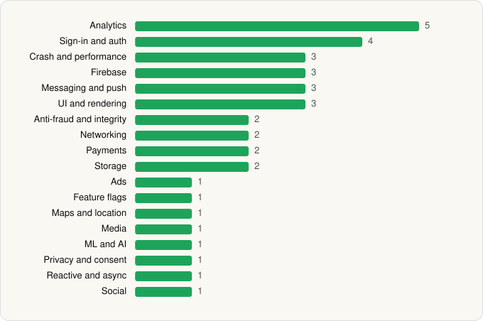

<picture><source media="(prefers-color-scheme: dark)" srcset="../../../../assets/logo/logo-dark.svg"></picture> [Tech Stack](../../../../README.md) / [Photoroom AI Photo Editor](../../../../companies/photoroom-ai-photo-editor.md) / Photoroom

# Photoroom: AI Photo Editor

<picture><source media="(prefers-color-scheme: dark)" srcset="../../../../assets/badges/android-dark.svg"></picture> <picture><source media="(prefers-color-scheme: dark)" srcset="../../../../assets/badges/active-dark.svg"></picture>

[Google Play](https://play.google.com/store/apps/details?id=com.photoroom.app) · [latest.json](latest.json)

| | |
|---|---|
| Company | [Photoroom AI Photo Editor](../../../../companies/photoroom-ai-photo-editor.md) |
| Store id | `com.photoroom.app` |
| Bundle / package id | `com.photoroom.app` |
| Latest version | 2026.43.04 (analysed 2026-10-24) |
| Versions tracked | 1 |
| SDKs in latest version | 37 |
| Languages | C/C++ (native), Java, Kotlin |
| UI | Jetpack Compose, Lottie, Material Components |
| Build | Gradle (inferred) |
| Minimum OS | API 29, targets API 36 |
| Devices / ABIs | Android |
| Capabilities | 10 |
| Declares tracking | Yes |
| Tracked | Yes |

## SDKs by category

<picture><source media="(prefers-color-scheme: dark)" srcset="../../../../assets/charts/apps/android/photoroom-ai-photo-editor/photoroom-dark.svg"></picture>

- **Analytics** (5): Adjust, Amplitude, Facebook SDK, Firebase Analytics, Google App Measurement
- **Sign-in and auth** (4): Credential Manager, Facebook Login, Firebase Auth, Google Sign-In / Auth
- **Crash and performance** (3): Datadog, Firebase Crashlytics, Firebase Performance
- **Firebase** (3): Firebase, Google DataTransport, Google Play services
- **Messaging and push** (3): Braze, Firebase Messaging, Intercom
- **UI and rendering** (3): Jetpack Compose, Lottie, Material Components
- **Anti-fraud and integrity** (2): Play Integrity, reCAPTCHA
- **Networking** (2): Ktor, OkHttp
- **Payments** (2): Google Play Billing, RevenueCat
- **Storage** (2): DataStore, Room
- **Ads** (1): Google Mobile Ads (AdMob)
- **Feature flags** (1): Firebase Remote Config
- **Maps and location** (1): Google Location
- **Media** (1): Media3 (ExoPlayer)
- **ML and AI** (1): ML Kit
- **Privacy and consent** (1): Didomi
- **Reactive and async** (1): Kotlin Coroutines
- **Social** (1): Facebook Share

Capabilities (10)

Advertising ID, Biometric auth, Camera, Fingerprint auth, Foreground service, Media: images, Microphone, Notifications, Storage (read), Storage (write)

## Version history

| Version | Analysed | Store update | SDKs | Change | SDK list is a floor | Binary encrypted | File |
|---|---|---|---|---|---|---|---|
| 2026.43.04 | 2026-10-24 | 2026-10-23 | 37 |  | No | No | [2026.43.04.json](2026.43.04.json) |

---

Generated by `scripts/build_readme.py` from the JSON files. Do not edit by hand.
