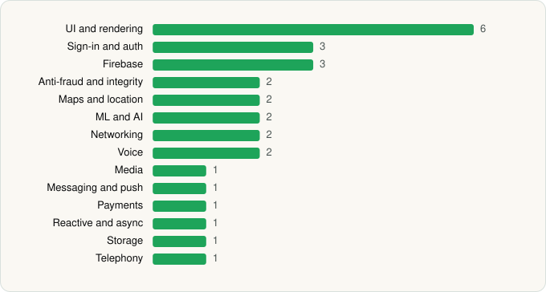

<picture><source media="(prefers-color-scheme: dark)" srcset="../../../../assets/logo/logo-dark.svg"></picture> [Tech Stack](../../../../README.md) / [Pickle, Inc.](../../../../companies/pickle-inc.md) / Pickle

# Pickle: Your personal AI agent

<picture><source media="(prefers-color-scheme: dark)" srcset="../../../../assets/badges/android-dark.svg"></picture> <picture><source media="(prefers-color-scheme: dark)" srcset="../../../../assets/badges/inactive-dark.svg"></picture>

[Google Play](https://play.google.com/store/apps/details?id=com.pickle.client) · [latest.json](latest.json)

| | |
|---|---|
| Company | [Pickle, Inc.](../../../../companies/pickle-inc.md) |
| Store id | `com.pickle.client` |
| Bundle / package id | `com.pickle.client` |
| Latest version | 1.1.18 (analysed 2026-11-19) |
| Versions tracked | 1 |
| SDKs in latest version | 28 |
| Languages | C/C++ (native), Java, Kotlin |
| UI | Coil, Glide, Jetpack Compose, Material Components, Picasso |
| Build | Gradle (inferred) |
| Minimum OS | API 32, targets API 36 |
| Devices / ABIs | Android |
| Capabilities | 16 |
| Declares tracking | Yes |
| Tracked | No. Kept for history. |

## SDKs by category

<picture><source media="(prefers-color-scheme: dark)" srcset="../../../../assets/charts/apps/android/pickle-inc/pickle-dark.svg"></picture>

- **UI and rendering** (6): AndroidSVG, Coil, Glide, Jetpack Compose, Material Components, Picasso
- **Sign-in and auth** (3): Auth0, Credential Manager, Google Sign-In / Auth
- **Firebase** (3): Firebase, Google DataTransport, Google Play services
- **Anti-fraud and integrity** (2): Play Integrity, reCAPTCHA
- **Maps and location** (2): Google Location, Google Maps
- **ML and AI** (2): ML Kit, ML Kit (barcode/vision)
- **Networking** (2): OkHttp, Retrofit
- **Voice** (2): LiveKit, WebRTC
- **Media** (1): Media3 (ExoPlayer)
- **Messaging and push** (1): Firebase Messaging
- **Payments** (1): Google Play Billing
- **Reactive and async** (1): Kotlin Coroutines
- **Storage** (1): DataStore
- **Telephony** (1): libphonenumber

Capabilities (16)

Approximate location, Biometric auth, Bluetooth, Bluetooth (connect), Calendar (read), Calendar (write), Camera, Contacts (read), Fingerprint auth, Foreground service, Foreground service: microphone, Media: images, Media: video, Microphone, Notifications, Precise location

## Version history

| Version | Analysed | Store update | SDKs | Change | SDK list is a floor | Binary encrypted | File |
|---|---|---|---|---|---|---|---|
| 1.1.18 | 2026-11-19 |  | 28 |  | No | No | [1.1.18.json](1.1.18.json) |

---

Generated by `scripts/build_readme.py` from the JSON files. Do not edit by hand.
