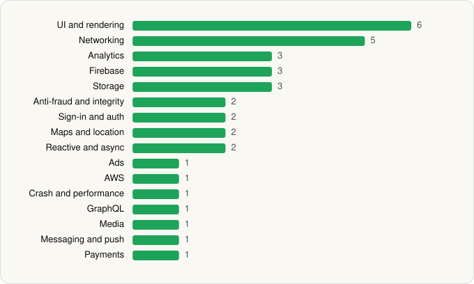

<picture><source media="(prefers-color-scheme: dark)" srcset="../../../../assets/logo/logo-dark.svg"></picture> [Tech Stack](../../../../README.md) / [Pinterest](../../../../companies/pinterest.md) / Pinterest

# Pinterest

<picture><source media="(prefers-color-scheme: dark)" srcset="../../../../assets/badges/android-dark.svg"></picture> <picture><source media="(prefers-color-scheme: dark)" srcset="../../../../assets/badges/active-dark.svg"></picture>

[Google Play](https://play.google.com/store/apps/details?id=com.pinterest) · [latest.json](latest.json)

| | |
|---|---|
| Company | [Pinterest](../../../../companies/pinterest.md) |
| Store id | `com.pinterest` |
| Bundle / package id | `com.pinterest` |
| Latest version | 14.21.0 (analysed 2026-06-19) |
| Versions tracked | 1 |
| SDKs in latest version | 35 |
| Languages | C/C++ (native), Java, Kotlin |
| UI | Coil, Glide, Jetpack Compose, Lottie, Material Components |
| Build | Gradle (inferred) |
| Minimum OS | API 28, targets API 36 |
| Devices / ABIs | Android |
| Capabilities | 12 |
| Declares tracking | Yes |
| Tracked | Yes |

## SDKs by category

<picture><source media="(prefers-color-scheme: dark)" srcset="../../../../assets/charts/apps/android/pinterest/pinterest-dark.svg"></picture>

- **UI and rendering** (6): AndroidSVG, Coil, Glide, Jetpack Compose, Lottie, Material Components
- **Networking** (5): Cronet, Cronet (Chromium net), Cronet (Google), OkHttp, Retrofit
- **Analytics** (3): AppsFlyer, Firebase Analytics, Google App Measurement
- **Firebase** (3): Firebase, Google DataTransport, Google Play services
- **Storage** (3): DataStore, Room, SQLDelight
- **Anti-fraud and integrity** (2): Play Integrity, reCAPTCHA
- **Sign-in and auth** (2): Credential Manager, Google Sign-In / Auth
- **Maps and location** (2): Google Location, Google Maps
- **Reactive and async** (2): Kotlin Coroutines, RxJava
- **Ads** (1): Google Mobile Ads (AdMob)
- **AWS** (1): AWS SDK
- **Crash and performance** (1): Bugsnag
- **GraphQL** (1): Apollo GraphQL
- **Media** (1): Media3 (ExoPlayer)
- **Messaging and push** (1): Firebase Messaging
- **Payments** (1): Google Play Billing

Capabilities (12)

Advertising ID, Approximate location, Camera, Contacts (read), Foreground service, Media: images, Media: video, NFC, Notifications, Precise location, Storage (read), Storage (write)

## Version history

| Version | Analysed | Store update | SDKs | Change | SDK list is a floor | Binary encrypted | File |
|---|---|---|---|---|---|---|---|
| 14.21.0 | 2026-06-19 |  | 35 |  | No | No | [14.21.0.json](14.21.0.json) |

---

Generated by `scripts/build_readme.py` from the JSON files. Do not edit by hand.
