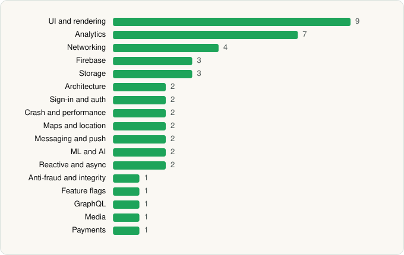

<picture><source media="(prefers-color-scheme: dark)" srcset="../../../../assets/logo/logo-dark.svg"></picture> [Tech Stack](../../../../README.md) / [Pizza Hut Inc](../../../../companies/pizza-hut-inc.md) / Pizza Hut

# Pizza Hut - Delivery & Takeout

<picture><source media="(prefers-color-scheme: dark)" srcset="../../../../assets/badges/android-dark.svg"></picture> <picture><source media="(prefers-color-scheme: dark)" srcset="../../../../assets/badges/inactive-dark.svg"></picture> <picture><source media="(prefers-color-scheme: dark)" srcset="../../../../assets/badges/floor-dark.svg"></picture>

[Google Play](https://play.google.com/store/apps/details?id=com.yum.pizzahut) · [latest.json](latest.json)

| | |
|---|---|
| Company | [Pizza Hut Inc](../../../../companies/pizza-hut-inc.md) |
| Store id | `com.yum.pizzahut` |
| Bundle / package id | `com.yum.pizzahut` |
| Latest version | 6.1.10 (analysed 2026-06-19) |
| Versions tracked | 1 |
| SDKs in latest version | 45 |
| Languages | C/C++ (native), Java, Kotlin, React Native / JavaScript |
| UI | Coil, Fresco, Glide, Jetpack Compose, Material Components |
| Build | Gradle (inferred), R8 / ProGuard (name obfuscation detected) |
| Minimum OS | API 24, targets API 36 |
| Devices / ABIs | Android |
| Capabilities | 10 |
| Declares tracking | Yes |
| Tracked | No. Kept for history. |

## SDKs by category

<picture><source media="(prefers-color-scheme: dark)" srcset="../../../../assets/charts/apps/android/pizza-hut-inc/pizza-hut-dark.svg"></picture>

- **UI and rendering** (9): AndroidSVG, Coil, FlashList, Fresco, Glide, Jetpack Compose, Material Components, React Native Reanimated, react-native-svg
- **Analytics** (7): Amplitude, AppsFlyer, Branch, Firebase Analytics, FullStory, Google App Measurement, Medallia
- **Networking** (4): axios, OkHttp, Retrofit, TanStack Query
- **Firebase** (3): Firebase, Google DataTransport, Google Play services
- **Storage** (3): DataStore, Okio, Room
- **Architecture** (2): MobX, Redux
- **Sign-in and auth** (2): AppAuth, Google Sign-In / Auth
- **Crash and performance** (2): Datadog, Firebase Crashlytics
- **Maps and location** (2): Google Location, Google Maps
- **Messaging and push** (2): Braze, Firebase Messaging
- **ML and AI** (2): ML Kit, ML Kit (barcode/vision)
- **Reactive and async** (2): Kotlin Coroutines, RxJava
- **Anti-fraud and integrity** (1): Play Integrity
- **Feature flags** (1): Firebase Remote Config
- **GraphQL** (1): Apollo GraphQL
- **Media** (1): Media3 (ExoPlayer)
- **Payments** (1): Braintree

Capabilities (10)

Advertising ID, Approximate location, Biometric auth, Draw over other apps, Fingerprint auth, Foreground service, Notifications, Precise location, Storage (read), Storage (write)

## Version history

| Version | Analysed | Store update | SDKs | Change | SDK list is a floor | Binary encrypted | File |
|---|---|---|---|---|---|---|---|
| 6.1.10 | 2026-06-19 |  | 45 |  | Yes | No | [6.1.10.json](6.1.10.json) |

## Model-written summary

> Android app with React Native (Hermes) + Jetpack Compose, on-device ML barcode scanning, Braintree payments, Braze/Firebase analytics, and root detection

Written by a language model from the detected signals (`inferred[]`). It is commentary, not measurement.

---

Generated by `scripts/build_readme.py` from the JSON files. Do not edit by hand.
