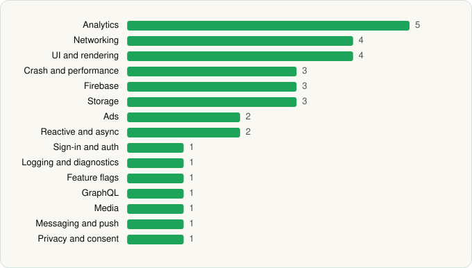

<picture><source media="(prefers-color-scheme: dark)" srcset="../../../../assets/logo/logo-dark.svg"></picture> [Tech Stack](../../../../README.md) / [Pluto, Inc.](../../../../companies/pluto-inc.md) / PlutoTV

# PlutoTV: Stream Free Movies/TV

<picture><source media="(prefers-color-scheme: dark)" srcset="../../../../assets/badges/android-dark.svg"></picture> <picture><source media="(prefers-color-scheme: dark)" srcset="../../../../assets/badges/inactive-dark.svg"></picture>

[Google Play](https://play.google.com/store/apps/details?id=tv.pluto.android) · [latest.json](latest.json)

| | |
|---|---|
| Company | [Pluto, Inc.](../../../../companies/pluto-inc.md) |
| Store id | `tv.pluto.android` |
| Bundle / package id | `tv.pluto.android` |
| Latest version | 5.66.0-leanback (analysed 2026-06-19) |
| Versions tracked | 1 |
| SDKs in latest version | 33 |
| Languages | C/C++ (native), Java, Kotlin |
| UI | Glide, Jetpack Compose, Lottie, Material Components |
| Build | Gradle (inferred) |
| Minimum OS | API 21, targets API 35 |
| Devices / ABIs | Android |
| Capabilities | 3 |
| Declares tracking | Yes |
| Tracked | No. Kept for history. |

## SDKs by category

<picture><source media="(prefers-color-scheme: dark)" srcset="../../../../assets/charts/apps/android/pluto-inc/plutotv-dark.svg"></picture>

- **Analytics** (5): Adobe Experience Platform, comScore, Firebase Analytics, Google App Measurement, Kochava
- **Networking** (4): Ktor, OkHttp, Retrofit, Volley
- **UI and rendering** (4): Glide, Jetpack Compose, Lottie, Material Components
- **Crash and performance** (3): Datadog, Firebase Crashlytics, Firebase Performance
- **Firebase** (3): Firebase, Google DataTransport, Google Play services
- **Storage** (3): DataStore, Okio, Room
- **Ads** (2): Google Ad Manager, Google Mobile Ads (AdMob)
- **Reactive and async** (2): Kotlin Coroutines, RxJava
- **Sign-in and auth** (1): Google Sign-In / Auth
- **Logging and diagnostics** (1): LeakCanary
- **Feature flags** (1): Firebase Remote Config
- **GraphQL** (1): Apollo GraphQL
- **Media** (1): Media3 (ExoPlayer)
- **Messaging and push** (1): Braze
- **Privacy and consent** (1): OneTrust

Capabilities (3)

Advertising ID, Foreground service, Notifications

## Version history

| Version | Analysed | Store update | SDKs | Change | SDK list is a floor | Binary encrypted | File |
|---|---|---|---|---|---|---|---|
| 5.66.0-leanback | 2026-06-19 |  | 33 |  | No | No | [5.66.0-leanback.json](5.66.0-leanback.json) |

---

Generated by `scripts/build_readme.py` from the JSON files. Do not edit by hand.
