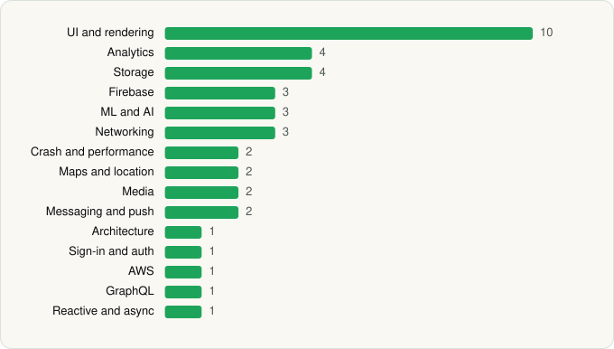

<picture><source media="(prefers-color-scheme: dark)" srcset="../../../../assets/logo/logo-dark.svg"></picture> [Tech Stack](../../../../README.md) / [Pomegranate Technologies](../../../../companies/pomegranate-technologies.md) / Kohl Wholesale

# Kohl Wholesale

<picture><source media="(prefers-color-scheme: dark)" srcset="../../../../assets/badges/android-dark.svg"></picture> <picture><source media="(prefers-color-scheme: dark)" srcset="../../../../assets/badges/inactive-dark.svg"></picture>

[Google Play](https://play.google.com/store/apps/details?id=com.usepepper.kohlwholesaleapp) · [latest.json](latest.json)

| | |
|---|---|
| Company | [Pomegranate Technologies](../../../../companies/pomegranate-technologies.md) |
| Store id | `com.usepepper.kohlwholesaleapp` |
| Bundle / package id | `com.usepepper.kohlwholesaleapp` |
| Latest version | 1.21.33 (analysed 2026-06-19) |
| Versions tracked | 1 |
| SDKs in latest version | 40 |
| Languages | C/C++ (native), Java, Kotlin, React Native / JavaScript |
| UI | Coil, Fresco, Glide, Jetpack Compose, Lottie, Material Components |
| Build | Gradle (inferred) |
| Minimum OS | API 24, targets API 35 |
| Devices / ABIs | Android |
| Capabilities | 20 |
| Declares tracking | Yes |
| Tracked | No. Kept for history. |

## SDKs by category

<picture><source media="(prefers-color-scheme: dark)" srcset="../../../../assets/charts/apps/android/pomegranate-technologies/kohl-wholesale-dark.svg"></picture>

- **UI and rendering** (10): AndroidSVG, Coil, FlashList, Fresco, Glide, Jetpack Compose, Lottie, Material Components, React Native Reanimated, react-native-svg
- **Analytics** (4): Amplitude, Branch, Firebase Analytics, Segment
- **Storage** (4): MMKV, Okio, Realm, Room
- **Firebase** (3): Firebase, Google DataTransport, Google Play services
- **ML and AI** (3): ML Kit, ML Kit (barcode/vision), TensorFlow Lite
- **Networking** (3): OkHttp, Retrofit, TanStack Query
- **Crash and performance** (2): Sentry, Sentry (native)
- **Maps and location** (2): Google Location, Google Maps
- **Media** (2): ExoPlayer, Media3 (ExoPlayer)
- **Messaging and push** (2): Firebase Messaging, Intercom
- **Architecture** (1): Redux
- **Sign-in and auth** (1): Google Sign-In / Auth
- **AWS** (1): AWS SDK
- **GraphQL** (1): Apollo GraphQL
- **Reactive and async** (1): Kotlin Coroutines

Capabilities (20)

Approximate location, Biometric auth, Bluetooth, Bluetooth (connect), Bluetooth (scan), Calendar (read), Calendar (write), Camera, Contacts (read), Contacts (write), Draw over other apps, Fingerprint auth, Foreground service, Foreground service: media playback, Media: audio, Microphone, Notifications, Precise location, Storage (read), Storage (write)

## Version history

| Version | Analysed | Store update | SDKs | Change | SDK list is a floor | Binary encrypted | File |
|---|---|---|---|---|---|---|---|
| 1.21.33 | 2026-06-19 |  | 40 |  | No | No | [1.21.33.json](1.21.33.json) |

---

Generated by `scripts/build_readme.py` from the JSON files. Do not edit by hand.
