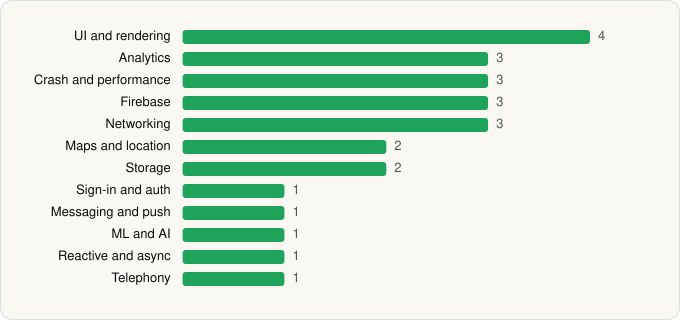

<picture><source media="(prefers-color-scheme: dark)" srcset="../../../../assets/logo/logo-dark.svg"></picture> [Tech Stack](../../../../README.md) / [Posten & Bring](../../../../companies/posten-bring.md) / Bring

# Bring

<picture><source media="(prefers-color-scheme: dark)" srcset="../../../../assets/badges/android-dark.svg"></picture> <picture><source media="(prefers-color-scheme: dark)" srcset="../../../../assets/badges/inactive-dark.svg"></picture>

[Google Play](https://play.google.com/store/apps/details?id=com.bring.sporing.controller) · [latest.json](latest.json)

| | |
|---|---|
| Company | [Posten & Bring](../../../../companies/posten-bring.md) |
| Store id | `com.bring.sporing.controller` |
| Bundle / package id | `com.bring.sporing.controller` |
| Latest version | 8.4.5 (analysed 2026-11-13) |
| Versions tracked | 1 |
| SDKs in latest version | 25 |
| Languages | C/C++ (native), Java, Kotlin |
| UI | Coil, Jetpack Compose, Material Components |
| Build | Gradle (inferred) |
| Minimum OS | API 24, targets API 37 |
| Devices / ABIs | Android |
| Capabilities | 10 |
| Declares tracking | Yes |
| Tracked | No. Kept for history. |

## SDKs by category

<picture><source media="(prefers-color-scheme: dark)" srcset="../../../../assets/charts/apps/android/posten-bring/bring-dark.svg"></picture>

- **UI and rendering** (4): AndroidSVG, Coil, Jetpack Compose, Material Components
- **Analytics** (3): Amplitude, Firebase Analytics, Google App Measurement
- **Crash and performance** (3): Firebase Crashlytics, Sentry, Sentry (native)
- **Firebase** (3): Firebase, Google DataTransport, Google Play services
- **Networking** (3): Ktor, OkHttp, Retrofit
- **Maps and location** (2): Google Location, Google Maps
- **Storage** (2): DataStore, Room
- **Sign-in and auth** (1): Google Sign-In / Auth
- **Messaging and push** (1): Firebase Messaging
- **ML and AI** (1): ML Kit
- **Reactive and async** (1): Kotlin Coroutines
- **Telephony** (1): libphonenumber

Capabilities (10)

Approximate location, Background location, Bluetooth, Bluetooth (connect), Bluetooth (scan), Camera, Foreground service, Notifications, Precise location, Storage (read)

## Version history

| Version | Analysed | Store update | SDKs | Change | SDK list is a floor | Binary encrypted | File |
|---|---|---|---|---|---|---|---|
| 8.4.5 | 2026-11-13 |  | 25 |  | No | No | [8.4.5.json](8.4.5.json) |

---

Generated by `scripts/build_readme.py` from the JSON files. Do not edit by hand.
