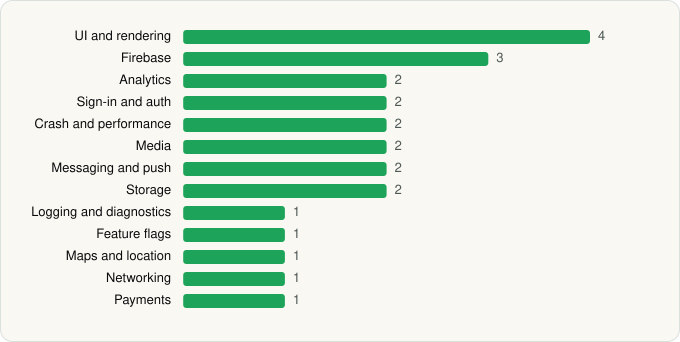

<picture><source media="(prefers-color-scheme: dark)" srcset="../../../../assets/logo/logo-dark.svg"></picture> [Tech Stack](../../../../README.md) / [Qobuz](../../../../companies/qobuz.md) / Qobuz

# Qobuz: Music & Editorial

<picture><source media="(prefers-color-scheme: dark)" srcset="../../../../assets/badges/android-dark.svg"></picture> <picture><source media="(prefers-color-scheme: dark)" srcset="../../../../assets/badges/inactive-dark.svg"></picture>

[Google Play](https://play.google.com/store/apps/details?id=com.qobuz.music) · [latest.json](latest.json)

| | |
|---|---|
| Company | [Qobuz](../../../../companies/qobuz.md) |
| Store id | `com.qobuz.music` |
| Bundle / package id | `com.qobuz.music` |
| Latest version | 9.10.0.1 (analysed 2026-06-19) |
| Versions tracked | 1 |
| SDKs in latest version | 24 |
| Languages | C/C++ (native), Java, Kotlin |
| UI | Glide, Jetpack Compose, Lottie, Material Components |
| Build | Gradle (inferred) |
| Minimum OS | API 23, targets API 36 |
| Devices / ABIs | Android |
| Capabilities | 7 |
| Declares tracking | Yes |
| Tracked | No. Kept for history. |

## SDKs by category

<picture><source media="(prefers-color-scheme: dark)" srcset="../../../../assets/charts/apps/android/qobuz/qobuz-dark.svg"></picture>

- **UI and rendering** (4): Glide, Jetpack Compose, Lottie, Material Components
- **Firebase** (3): Firebase, Google DataTransport, Google Play services
- **Analytics** (2): Facebook SDK, Firebase Analytics
- **Sign-in and auth** (2): Facebook Login, Google Sign-In / Auth
- **Crash and performance** (2): Firebase Crashlytics, Firebase Performance
- **Media** (2): Google Cast, Media3 (ExoPlayer)
- **Messaging and push** (2): Braze, Firebase Messaging
- **Storage** (2): DataStore, Room
- **Logging and diagnostics** (1): Chucker
- **Feature flags** (1): Firebase Remote Config
- **Maps and location** (1): Google Location
- **Networking** (1): OkHttp
- **Payments** (1): Google Play Billing

Capabilities (7)

Advertising ID, Bluetooth, Foreground service, Foreground service: media playback, Notifications, Storage (read), Storage (write)

## Version history

| Version | Analysed | Store update | SDKs | Change | SDK list is a floor | Binary encrypted | File |
|---|---|---|---|---|---|---|---|
| 9.10.0.1 | 2026-06-19 |  | 24 |  | No | No | [9.10.0.1.json](9.10.0.1.json) |

## Model-written summary

> Android music streaming app in Kotlin with Jetpack Compose, Media3/ExoPlayer, native FLAC, Firebase services, Braze and Google Cast.

Written by a language model from the detected signals (`inferred[]`). It is commentary, not measurement.

---

Generated by `scripts/build_readme.py` from the JSON files. Do not edit by hand.
