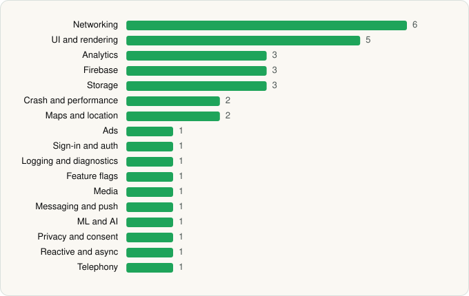

<picture><source media="(prefers-color-scheme: dark)" srcset="../../../../assets/logo/logo-dark.svg"></picture> [Tech Stack](../../../../README.md) / [Rakuten Group, Inc.](../../../../companies/rakuten-group-inc.md) / Rakuten Travel

# Rakuten Travel: Hotel Booking

<picture><source media="(prefers-color-scheme: dark)" srcset="../../../../assets/badges/android-dark.svg"></picture> <picture><source media="(prefers-color-scheme: dark)" srcset="../../../../assets/badges/inactive-dark.svg"></picture>

[Google Play](https://play.google.com/store/apps/details?id=com.rakuten.travel.consumer) · [latest.json](latest.json)

| | |
|---|---|
| Company | [Rakuten Group, Inc.](../../../../companies/rakuten-group-inc.md) |
| Store id | `com.rakuten.travel.consumer` |
| Bundle / package id | `com.rakuten.travel.consumer` |
| Latest version | 5.12.10 (analysed 2026-06-19) |
| Versions tracked | 1 |
| SDKs in latest version | 34 |
| Languages | C/C++ (native), Java, Kotlin |
| UI | Coil, Glide, Jetpack Compose, Material Components, Picasso |
| Build | Gradle (inferred) |
| Minimum OS | API 29, targets API 35 |
| Devices / ABIs | Android |
| Capabilities | 11 |
| Declares tracking | Yes |
| Tracked | No. Kept for history. |

## SDKs by category

<picture><source media="(prefers-color-scheme: dark)" srcset="../../../../assets/charts/apps/android/rakuten-group-inc/rakuten-travel-dark.svg"></picture>

- **Networking** (6): Cronet, Cronet (Google), Ktor, OkHttp, Retrofit, Volley
- **UI and rendering** (5): Coil, Glide, Jetpack Compose, Material Components, Picasso
- **Analytics** (3): Adjust, Firebase Analytics, Google App Measurement
- **Firebase** (3): Firebase, Google DataTransport, Google Play services
- **Storage** (3): DataStore, Okio, Room
- **Crash and performance** (2): Firebase Crashlytics, Firebase Performance
- **Maps and location** (2): Google Location, Google Maps
- **Ads** (1): Google Mobile Ads (AdMob)
- **Sign-in and auth** (1): Google Sign-In / Auth
- **Logging and diagnostics** (1): Chucker
- **Feature flags** (1): Firebase Remote Config
- **Media** (1): Media3 (ExoPlayer)
- **Messaging and push** (1): Firebase Messaging
- **ML and AI** (1): OpenCV
- **Privacy and consent** (1): OneTrust
- **Reactive and async** (1): Kotlin Coroutines
- **Telephony** (1): libphonenumber

Capabilities (11)

Advertising ID, Approximate location, Biometric auth, Bluetooth, Camera, Fingerprint auth, Foreground service, Notifications, Precise location, Storage (read), Storage (write)

## Version history

| Version | Analysed | Store update | SDKs | Change | SDK list is a floor | Binary encrypted | File |
|---|---|---|---|---|---|---|---|
| 5.12.10 | 2026-06-19 |  | 34 |  | No | No | [5.12.10.json](5.12.10.json) |

## Model-written summary

> Android Rakuten Travel app with first-party Rakuten backends, Jetpack Compose UI, Firebase+Adjust analytics, OpenCV/CardIO natives, and biometric security

Written by a language model from the detected signals (`inferred[]`). It is commentary, not measurement.

---

Generated by `scripts/build_readme.py` from the JSON files. Do not edit by hand.
