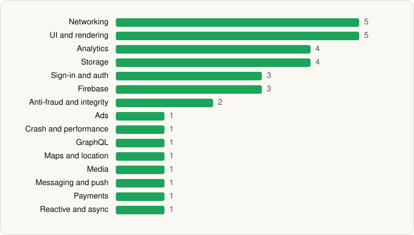

<picture><source media="(prefers-color-scheme: dark)" srcset="../../../../assets/logo/logo-dark.svg"></picture> [Tech Stack](../../../../README.md) / [reddit Inc.](../../../../companies/reddit-inc.md) / Reddit

# Reddit

<picture><source media="(prefers-color-scheme: dark)" srcset="../../../../assets/badges/android-dark.svg"></picture> <picture><source media="(prefers-color-scheme: dark)" srcset="../../../../assets/badges/inactive-dark.svg"></picture>

[Google Play](https://play.google.com/store/apps/details?id=com.reddit.frontpage) · [latest.json](latest.json)

| | |
|---|---|
| Company | [reddit Inc.](../../../../companies/reddit-inc.md) |
| Store id | `com.reddit.frontpage` |
| Bundle / package id | `com.reddit.frontpage` |
| Latest version | 2026.22.0 (analysed 2026-06-19) |
| Versions tracked | 1 |
| SDKs in latest version | 34 |
| Languages | C/C++ (native), Java, Kotlin |
| UI | Glide, Jetpack Compose, Lottie, Material Components |
| Build | Gradle (inferred) |
| Minimum OS | API 29, targets API 36 |
| Devices / ABIs | Android |
| Capabilities | 13 |
| Declares tracking | Yes |
| Tracked | No. Kept for history. |

## SDKs by category

<picture><source media="(prefers-color-scheme: dark)" srcset="../../../../assets/charts/apps/android/reddit-inc/reddit-dark.svg"></picture>

- **Networking** (5): Cronet, Cronet (Chromium net), Cronet (Google), OkHttp, Retrofit
- **UI and rendering** (5): AndroidSVG, Glide, Jetpack Compose, Lottie, Material Components
- **Analytics** (4): AppsFlyer, Branch, Firebase Analytics, Google App Measurement
- **Storage** (4): DataStore, Okio, Room, SQLDelight
- **Sign-in and auth** (3): Credential Manager, Firebase Auth, Google Sign-In / Auth
- **Firebase** (3): Firebase, Google DataTransport, Google Play services
- **Anti-fraud and integrity** (2): Play Integrity, reCAPTCHA
- **Ads** (1): Google Mobile Ads (AdMob)
- **Crash and performance** (1): Firebase Crashlytics
- **GraphQL** (1): Apollo GraphQL
- **Maps and location** (1): Google Location
- **Media** (1): Media3 (ExoPlayer)
- **Messaging and push** (1): Firebase Messaging
- **Payments** (1): Google Play Billing
- **Reactive and async** (1): Kotlin Coroutines

Capabilities (13)

Advertising ID, Approximate location, Biometric auth, Camera, Fingerprint auth, Foreground service, Media: audio, Media: images, Media: video, Microphone, Notifications, Storage (read), Storage (write)

## Version history

| Version | Analysed | Store update | SDKs | Change | SDK list is a floor | Binary encrypted | File |
|---|---|---|---|---|---|---|---|
| 2026.22.0 | 2026-06-19 |  | 34 |  | No | No | [2026.22.0.json](2026.22.0.json) |

---

Generated by `scripts/build_readme.py` from the JSON files. Do not edit by hand.
