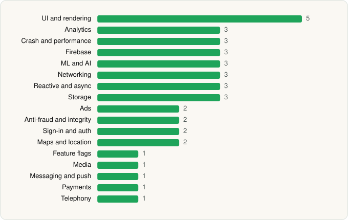

<picture><source media="(prefers-color-scheme: dark)" srcset="../../../../assets/logo/logo-dark.svg"></picture> [Tech Stack](../../../../README.md) / [Revolut Ltd](../../../../companies/revolut-ltd.md) / Revolut

# Revolut: Spend, Save, Trade

<picture><source media="(prefers-color-scheme: dark)" srcset="../../../../assets/badges/android-dark.svg"></picture> <picture><source media="(prefers-color-scheme: dark)" srcset="../../../../assets/badges/active-dark.svg"></picture> <picture><source media="(prefers-color-scheme: dark)" srcset="../../../../assets/badges/floor-dark.svg"></picture>

[Google Play](https://play.google.com/store/apps/details?id=com.revolut.revolut) · [latest.json](latest.json)

| | |
|---|---|
| Company | [Revolut Ltd](../../../../companies/revolut-ltd.md) |
| Store id | `com.revolut.revolut` |
| Bundle / package id | `com.revolut.revolut` |
| Latest version | 10.152 (analysed 2026-10-24) |
| Versions tracked | 1 |
| SDKs in latest version | 39 |
| Languages | C/C++ (native), Java, Kotlin |
| UI | Glide, Jetpack Compose, Lottie, Material Components |
| Build | Gradle (inferred), Packer/hardening: DexProtector |
| Minimum OS | API 28, targets API 36 |
| Devices / ABIs | Android |
| Capabilities | 20 |
| Declares tracking | Yes |
| Tracked | Yes |

## SDKs by category

<picture><source media="(prefers-color-scheme: dark)" srcset="../../../../assets/charts/apps/android/revolut-ltd/revolut-dark.svg"></picture>

- **UI and rendering** (5): AndroidSVG, Glide, Jetpack Compose, Lottie, Material Components
- **Analytics** (3): AppsFlyer, Firebase Analytics, Google App Measurement
- **Crash and performance** (3): Firebase Crashlytics, Firebase Performance, Sentry
- **Firebase** (3): Firebase, Google DataTransport, Google Play services
- **ML and AI** (3): ML Kit, TensorFlow, TensorFlow Lite
- **Networking** (3): Ktor, OkHttp, Retrofit
- **Reactive and async** (3): Kotlin Coroutines, RxJava, RxJava 3
- **Storage** (3): DataStore, Room, SQLCipher
- **Ads** (2): Google Ad Manager, Google Mobile Ads (AdMob)
- **Anti-fraud and integrity** (2): Onfido, Play Integrity
- **Sign-in and auth** (2): Credential Manager, Google Sign-In / Auth
- **Maps and location** (2): Google Location, Google Maps
- **Feature flags** (1): Firebase Remote Config
- **Media** (1): Media3 (ExoPlayer)
- **Messaging and push** (1): Firebase Messaging
- **Payments** (1): Google Play Billing
- **Telephony** (1): libphonenumber

Capabilities (20)

Advertising ID, Approximate location, Biometric auth, Bluetooth, Bluetooth (connect), Bluetooth (scan), Camera, Contacts (read), Contacts (write), Fingerprint auth, Foreground service, Foreground service: microphone, Microphone, NFC, Notifications, Phone / carrier info, Precise location, Query all installed apps, Storage (read), Storage (write)

## Version history

| Version | Analysed | Store update | SDKs | Change | SDK list is a floor | Binary encrypted | File |
|---|---|---|---|---|---|---|---|
| 10.152 | 2026-10-24 | 2026-10-21 | 39 |  | Yes | No | [10.152.json](10.152.json) |

---

Generated by `scripts/build_readme.py` from the JSON files. Do not edit by hand.
