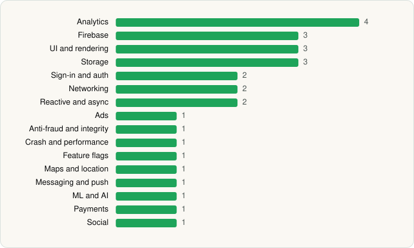

<picture><source media="(prefers-color-scheme: dark)" srcset="../../../../assets/logo/logo-dark.svg"></picture> [Tech Stack](../../../../README.md) / [Roadget Business PTE. LTD.](../../../../companies/roadget-business-pte-ltd.md) / SHEIN-Shopping Online

# SHEIN-Shopping Online

<picture><source media="(prefers-color-scheme: dark)" srcset="../../../../assets/badges/android-dark.svg"></picture> <picture><source media="(prefers-color-scheme: dark)" srcset="../../../../assets/badges/inactive-dark.svg"></picture>

[Google Play](https://play.google.com/store/apps/details?id=com.zzkko) · [latest.json](latest.json)

| | |
|---|---|
| Company | [Roadget Business PTE. LTD.](../../../../companies/roadget-business-pte-ltd.md) |
| Store id | `com.zzkko` |
| Bundle / package id | `com.zzkko` |
| Latest version | 15.5.0 (analysed 2026-10-24) |
| Versions tracked | 1 |
| SDKs in latest version | 28 |
| Languages | C/C++ (native), Java, Kotlin |
| UI | Fresco, Lottie, Material Components |
| Build | Gradle (inferred) |
| Minimum OS | API 23, targets API 36 |
| Devices / ABIs | Android |
| Capabilities | 13 |
| Declares tracking | Yes |
| Tracked | No. Kept for history. |

## SDKs by category

<picture><source media="(prefers-color-scheme: dark)" srcset="../../../../assets/charts/apps/android/roadget-business-pte-ltd/shein-shopping-online-dark.svg"></picture>

- **Analytics** (4): AppsFlyer, Facebook SDK, Firebase Analytics, Google App Measurement
- **Firebase** (3): Firebase, Google DataTransport, Google Play services
- **UI and rendering** (3): Fresco, Lottie, Material Components
- **Storage** (3): MMKV, Okio, Room
- **Sign-in and auth** (2): Facebook Login, Google Sign-In / Auth
- **Networking** (2): OkHttp, Retrofit
- **Reactive and async** (2): Kotlin Coroutines, RxJava
- **Ads** (1): Google Mobile Ads (AdMob)
- **Anti-fraud and integrity** (1): Play Integrity
- **Crash and performance** (1): Crashlytics
- **Feature flags** (1): Firebase Remote Config
- **Maps and location** (1): Google Maps
- **Messaging and push** (1): Firebase Messaging
- **ML and AI** (1): ML Kit
- **Payments** (1): Braintree
- **Social** (1): Facebook Share

Capabilities (13)

Advertising ID, Approximate location, Biometric auth, Calendar (read), Calendar (write), Camera, Draw over other apps, Fingerprint auth, Foreground service, Notifications, Precise location, Storage (read), Storage (write)

## Version history

| Version | Analysed | Store update | SDKs | Change | SDK list is a floor | Binary encrypted | File |
|---|---|---|---|---|---|---|---|
| 15.5.0 | 2026-10-24 | 2026-10-21 | 28 |  | No | No | [15.5.0.json](15.5.0.json) |

---

Generated by `scripts/build_readme.py` from the JSON files. Do not edit by hand.
