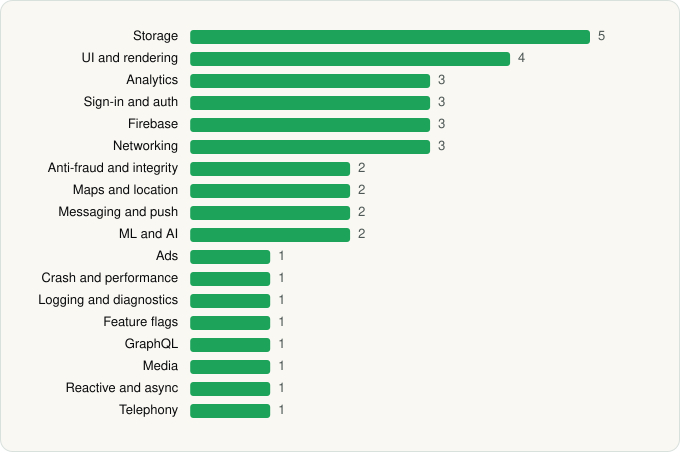

<picture><source media="(prefers-color-scheme: dark)" srcset="../../../../assets/logo/logo-dark.svg"></picture> [Tech Stack](../../../../README.md) / [Sam's Club](../../../../companies/sam-s-club.md) / Sam's Club

# Sam's Club: Shopping & Savings

<picture><source media="(prefers-color-scheme: dark)" srcset="../../../../assets/badges/android-dark.svg"></picture> <picture><source media="(prefers-color-scheme: dark)" srcset="../../../../assets/badges/inactive-dark.svg"></picture>

[Google Play](https://play.google.com/store/apps/details?id=com.rfi.sams.android) · [latest.json](latest.json)

| | |
|---|---|
| Company | [Sam's Club](../../../../companies/sam-s-club.md) |
| Store id | `com.rfi.sams.android` |
| Bundle / package id | `com.rfi.sams.android` |
| Latest version | 26.6.20 (analysed 2026-06-19) |
| Versions tracked | 1 |
| SDKs in latest version | 37 |
| Languages | C/C++ (native), Java, Kotlin |
| UI | Glide, Jetpack Compose, Lottie, Material Components |
| Build | Gradle (inferred) |
| Minimum OS | API 28, targets API 35 |
| Devices / ABIs | Android |
| Capabilities | 13 |
| Declares tracking | Yes |
| Tracked | No. Kept for history. |

## SDKs by category

<picture><source media="(prefers-color-scheme: dark)" srcset="../../../../assets/charts/apps/android/sam-s-club/sam-s-club-dark.svg"></picture>

- **Storage** (5): DataStore, Okio, Room, SQLCipher, SQLDelight
- **UI and rendering** (4): Glide, Jetpack Compose, Lottie, Material Components
- **Analytics** (3): Branch, Firebase Analytics, Google App Measurement
- **Sign-in and auth** (3): Credential Manager, Firebase Auth, Google Sign-In / Auth
- **Firebase** (3): Firebase, Google DataTransport, Google Play services
- **Networking** (3): Ktor, OkHttp, Retrofit
- **Anti-fraud and integrity** (2): Play Integrity, reCAPTCHA
- **Maps and location** (2): Google Location, Google Maps
- **Messaging and push** (2): Airship, Firebase Messaging
- **ML and AI** (2): ML Kit, ML Kit (barcode/vision)
- **Ads** (1): Google Mobile Ads (AdMob)
- **Crash and performance** (1): Firebase Crashlytics
- **Logging and diagnostics** (1): Flipper
- **Feature flags** (1): Firebase Remote Config
- **GraphQL** (1): Apollo GraphQL
- **Media** (1): ExoPlayer
- **Reactive and async** (1): Kotlin Coroutines
- **Telephony** (1): libphonenumber

Capabilities (13)

Advertising ID, Approximate location, Biometric auth, Camera, Fingerprint auth, Foreground service, Foreground service: location, Microphone, Notifications, Phone / carrier info, Precise location, Storage (read), Storage (write)

## Version history

| Version | Analysed | Store update | SDKs | Change | SDK list is a floor | Binary encrypted | File |
|---|---|---|---|---|---|---|---|
| 26.6.20 | 2026-06-19 |  | 37 |  | No | No | [26.6.20.json](26.6.20.json) |

---

Generated by `scripts/build_readme.py` from the JSON files. Do not edit by hand.
