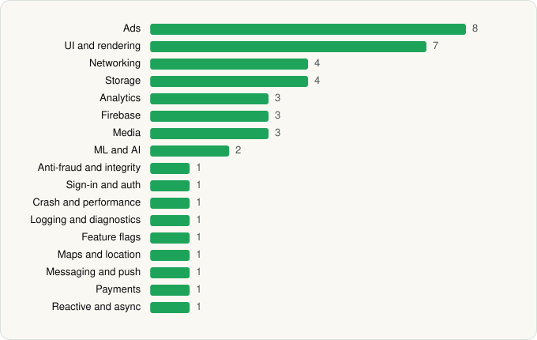

<picture><source media="(prefers-color-scheme: dark)" srcset="../../../../assets/logo/logo-dark.svg"></picture> [Tech Stack](../../../../README.md) / [Seekee Ltd](../../../../companies/seekee-ltd.md) / Seekee

# Seekee - AI Search & Assistant

<picture><source media="(prefers-color-scheme: dark)" srcset="../../../../assets/badges/android-dark.svg"></picture> <picture><source media="(prefers-color-scheme: dark)" srcset="../../../../assets/badges/inactive-dark.svg"></picture> <picture><source media="(prefers-color-scheme: dark)" srcset="../../../../assets/badges/floor-dark.svg"></picture>

[Google Play](https://play.google.com/store/apps/details?id=com.enzo.paulo) · [latest.json](latest.json)

| | |
|---|---|
| Company | [Seekee Ltd](../../../../companies/seekee-ltd.md) |
| Store id | `com.enzo.paulo` |
| Bundle / package id | `com.enzo.paulo` |
| Latest version | 2.19.0 (analysed 2026-11-06) |
| Versions tracked | 1 |
| SDKs in latest version | 43 |
| Languages | C/C++ (native), Java, Kotlin, Unity (C# / IL2CPP) |
| UI | Glide, Lottie, Material Components, Picasso |
| Build | Gradle (inferred), Packer/hardening: Google Play (pairip) anti-tamper |
| Minimum OS | API 24, targets API 36 |
| Devices / ABIs | Android |
| Capabilities | 16 |
| Declares tracking | Yes |
| Tracked | No. Kept for history. |

## SDKs by category

<picture><source media="(prefers-color-scheme: dark)" srcset="../../../../assets/charts/apps/android/seekee-ltd/seekee-dark.svg"></picture>

- **Ads** (8): AppLovin, Google Ad Manager, Google Mobile Ads (AdMob), Meta Audience Network, Mintegral, Pangle, Unity Ads, Vungle
- **UI and rendering** (7): AndroidSVG, Glide, jLaTeXMath, Lottie, Markwon, Material Components, Picasso
- **Networking** (4): Cronet, Cronet (Google), OkHttp, Retrofit
- **Storage** (4): DataStore, MMKV, Okio, Room
- **Analytics** (3): AppsFlyer, Firebase Analytics, Google App Measurement
- **Firebase** (3): Firebase, Google DataTransport, Google Play services
- **Media** (3): FFmpeg, Google Cast, Media3 (ExoPlayer)
- **ML and AI** (2): ML Kit, ML Kit (barcode/vision)
- **Anti-fraud and integrity** (1): Play Integrity
- **Sign-in and auth** (1): Google Sign-In / Auth
- **Crash and performance** (1): Firebase Crashlytics
- **Logging and diagnostics** (1): Chucker
- **Feature flags** (1): Firebase Remote Config
- **Maps and location** (1): Google Location
- **Messaging and push** (1): Firebase Messaging
- **Payments** (1): Google Play Billing
- **Reactive and async** (1): Kotlin Coroutines

Capabilities (16)

Advertising ID, Bluetooth, Bluetooth (connect), Bluetooth (scan), Camera, Draw over other apps, Foreground service, Foreground service: media playback, Media: audio, Media: images, Media: video, Microphone, Notifications, Phone / carrier info, Storage (read), Storage (write)

## Version history

| Version | Analysed | Store update | SDKs | Change | SDK list is a floor | Binary encrypted | File |
|---|---|---|---|---|---|---|---|
| 2.19.0 | 2026-11-06 | 2026-11-06 | 43 |  | Yes | No | [2.19.0.json](2.19.0.json) |

---

Generated by `scripts/build_readme.py` from the JSON files. Do not edit by hand.
