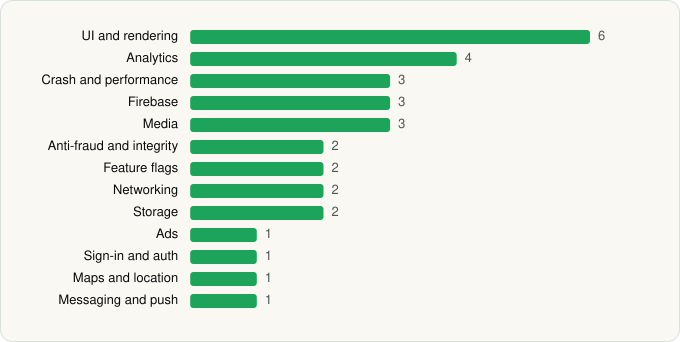

<picture><source media="(prefers-color-scheme: dark)" srcset="../../../../assets/logo/logo-dark.svg"></picture> [Tech Stack](../../../../README.md) / [Seven West Media](../../../../companies/seven-west-media.md) / 7plus

# 7plus

<picture><source media="(prefers-color-scheme: dark)" srcset="../../../../assets/badges/android-dark.svg"></picture> <picture><source media="(prefers-color-scheme: dark)" srcset="../../../../assets/badges/inactive-dark.svg"></picture>

[Google Play](https://play.google.com/store/apps/details?id=com.swm.live) · [latest.json](latest.json)

| | |
|---|---|
| Company | [Seven West Media](../../../../companies/seven-west-media.md) |
| Store id | `com.swm.live` |
| Bundle / package id | `com.swm.live` |
| Latest version | 8.0.1 (analysed 2026-11-10) |
| Versions tracked | 1 |
| SDKs in latest version | 31 |
| Languages | C/C++ (native), Java, Kotlin |
| UI | Coil, Jetpack Compose, Lottie, Material Components, Picasso |
| Build | Gradle (inferred) |
| Minimum OS | API 26, targets API 36 |
| Devices / ABIs | Android |
| Capabilities | 9 |
| Declares tracking | Yes |
| Tracked | No. Kept for history. |

## SDKs by category

<picture><source media="(prefers-color-scheme: dark)" srcset="../../../../assets/charts/apps/android/seven-west-media/7plus-dark.svg"></picture>

- **UI and rendering** (6): Coil, Jetpack Compose, Lottie, Markwon, Material Components, Picasso
- **Analytics** (4): Branch, Facebook SDK, Firebase Analytics, Google App Measurement
- **Crash and performance** (3): Firebase Crashlytics, Firebase Performance, Sentry
- **Firebase** (3): Firebase, Google DataTransport, Google Play services
- **Media** (3): Google Cast, Media3 (ExoPlayer), Mux
- **Anti-fraud and integrity** (2): Play Integrity, RootBeer
- **Feature flags** (2): Firebase Remote Config, LaunchDarkly
- **Networking** (2): OkHttp, Volley
- **Storage** (2): DataStore, Room
- **Ads** (1): Google Mobile Ads (AdMob)
- **Sign-in and auth** (1): Google Sign-In / Auth
- **Maps and location** (1): Google Location
- **Messaging and push** (1): Firebase Messaging

Capabilities (9)

Advertising ID, Approximate location, Bluetooth, Bluetooth (connect), Bluetooth (scan), Foreground service, Microphone, Notifications, Precise location

## Version history

| Version | Analysed | Store update | SDKs | Change | SDK list is a floor | Binary encrypted | File |
|---|---|---|---|---|---|---|---|
| 8.0.1 | 2026-11-10 |  | 31 |  | No | No | [8.0.1.json](8.0.1.json) |

---

Generated by `scripts/build_readme.py` from the JSON files. Do not edit by hand.
