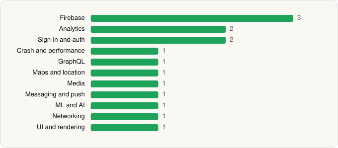

<picture><source media="(prefers-color-scheme: dark)" srcset="../../../../assets/logo/logo-dark.svg"></picture> [Tech Stack](../../../../README.md) / [Shopify Inc.](../../../../companies/shopify-inc.md) / Shop

# Shop: Track, Pay, Discover

<picture><source media="(prefers-color-scheme: dark)" srcset="../../../../assets/badges/android-dark.svg"></picture> <picture><source media="(prefers-color-scheme: dark)" srcset="../../../../assets/badges/inactive-dark.svg"></picture>

[Google Play](https://play.google.com/store/apps/details?id=com.shopify.arrive) · [latest.json](latest.json)

| | |
|---|---|
| Company | [Shopify Inc.](../../../../companies/shopify-inc.md) |
| Store id | `com.shopify.arrive` |
| Bundle / package id | `com.shopify.arrive` |
| Latest version | 3.18.0 (analysed 2026-11-14) |
| Versions tracked | 1 |
| SDKs in latest version | 15 |
| Languages | C/C++ (native), Java |
| UI | Jetpack Compose |
| Build | Gradle (inferred) |
| Minimum OS | API 29, targets API 36 |
| Devices / ABIs | Android |
| Capabilities | 8 |
| Declares tracking | Yes |
| Tracked | No. Kept for history. |

## SDKs by category

<picture><source media="(prefers-color-scheme: dark)" srcset="../../../../assets/charts/apps/android/shopify-inc/shop-dark.svg"></picture>

- **Firebase** (3): Firebase, Google DataTransport, Google Play services
- **Analytics** (2): Firebase Analytics, Google App Measurement
- **Sign-in and auth** (2): Credential Manager, Google Sign-In / Auth
- **Crash and performance** (1): Bugsnag
- **GraphQL** (1): Apollo GraphQL
- **Maps and location** (1): Google Maps
- **Media** (1): Media3 (ExoPlayer)
- **Messaging and push** (1): Firebase Messaging
- **ML and AI** (1): ML Kit
- **Networking** (1): OkHttp
- **UI and rendering** (1): Jetpack Compose

Capabilities (8)

Advertising ID, Approximate location, Biometric auth, Camera, Fingerprint auth, Microphone, Notifications, Precise location

## Version history

| Version | Analysed | Store update | SDKs | Change | SDK list is a floor | Binary encrypted | File |
|---|---|---|---|---|---|---|---|
| 3.18.0 | 2026-11-14 |  | 15 |  | No | No | [3.18.0.json](3.18.0.json) |

---

Generated by `scripts/build_readme.py` from the JSON files. Do not edit by hand.
