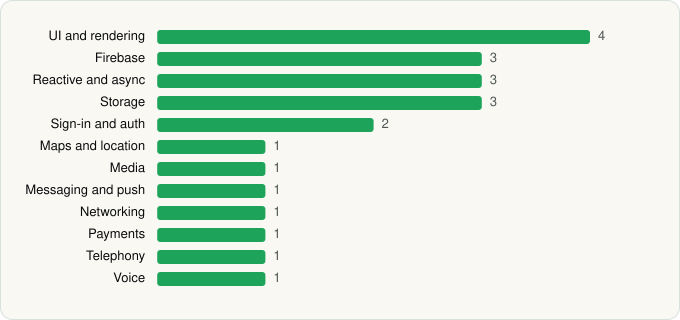

<picture><source media="(prefers-color-scheme: dark)" srcset="../../../../assets/logo/logo-dark.svg"></picture> [Tech Stack](../../../../README.md) / [Signal Foundation](../../../../companies/signal-foundation.md) / Signal Private Messenger

# Signal Private Messenger

<picture><source media="(prefers-color-scheme: dark)" srcset="../../../../assets/badges/android-dark.svg"></picture> <picture><source media="(prefers-color-scheme: dark)" srcset="../../../../assets/badges/active-dark.svg"></picture>

[Google Play](https://play.google.com/store/apps/details?id=org.thoughtcrime.securesms) · [latest.json](latest.json)

| | |
|---|---|
| Company | [Signal Foundation](../../../../companies/signal-foundation.md) |
| Store id | `org.thoughtcrime.securesms` |
| Bundle / package id | `org.thoughtcrime.securesms` |
| Latest version | 8.32.3 (analysed 2026-10-23) |
| Versions tracked | 2 |
| SDKs in latest version | 22 |
| Languages | C/C++ (native), Java, Kotlin |
| UI | Glide, Jetpack Compose, Lottie, Material Components |
| Build | Gradle (inferred) |
| Minimum OS | API 23, targets API 36 |
| Devices / ABIs | Android |
| Capabilities | 20 |
| Declares tracking | No |
| Tracked | Yes |

## SDKs by category

<picture><source media="(prefers-color-scheme: dark)" srcset="../../../../assets/charts/apps/android/signal-foundation/signal-private-messenger-dark.svg"></picture>

- **UI and rendering** (4): Glide, Jetpack Compose, Lottie, Material Components
- **Firebase** (3): Firebase, Google DataTransport, Google Play services
- **Reactive and async** (3): Kotlin Coroutines, RxJava, RxJava 3
- **Storage** (3): DataStore, Okio, SQLCipher
- **Sign-in and auth** (2): Credential Manager, Google Sign-In / Auth
- **Maps and location** (1): Google Maps
- **Media** (1): Media3 (ExoPlayer)
- **Messaging and push** (1): Firebase Messaging
- **Networking** (1): OkHttp
- **Payments** (1): Google Play Billing
- **Telephony** (1): libphonenumber
- **Voice** (1): WebRTC

Capabilities (20)

Approximate location, Biometric auth, Bluetooth, Bluetooth (connect), Camera, Contacts (read), Contacts (write), Fingerprint auth, Foreground service, Foreground service: camera, Foreground service: media playback, Foreground service: microphone, Media: images, Media: video, Microphone, Notifications, Phone / carrier info, Precise location, Storage (read), Storage (write)

## Version history

| Version | Analysed | Store update | SDKs | Change | SDK list is a floor | Binary encrypted | File |
|---|---|---|---|---|---|---|---|
| 8.32.3 | 2026-10-23 | 2026-10-22 | 22 | +0 / −0 | No | No | [8.32.3.json](8.32.3.json) |
| 8.12.4 | 2026-06-19 |  | 22 |  | No | No | [8.12.4.json](8.12.4.json) |

---

Generated by `scripts/build_readme.py` from the JSON files. Do not edit by hand.
