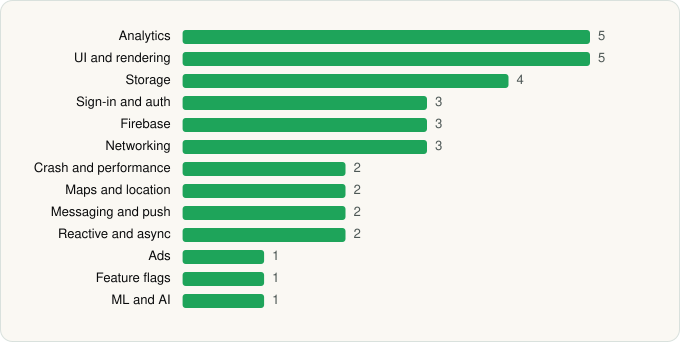

<picture><source media="(prefers-color-scheme: dark)" srcset="../../../../assets/logo/logo-dark.svg"></picture> [Tech Stack](../../../../README.md) / [Skyscanner Ltd](../../../../companies/skyscanner-ltd.md) / Skyscanner Flights Hotels Cars

# Skyscanner Flights Hotels Cars

<picture><source media="(prefers-color-scheme: dark)" srcset="../../../../assets/badges/android-dark.svg"></picture> <picture><source media="(prefers-color-scheme: dark)" srcset="../../../../assets/badges/inactive-dark.svg"></picture>

[Google Play](https://play.google.com/store/apps/details?id=net.skyscanner.android.main) · [latest.json](latest.json)

| | |
|---|---|
| Company | [Skyscanner Ltd](../../../../companies/skyscanner-ltd.md) |
| Store id | `net.skyscanner.android.main` |
| Bundle / package id | `net.skyscanner.android.main` |
| Latest version | 7.197 (analysed 2026-06-25) |
| Versions tracked | 1 |
| SDKs in latest version | 34 |
| Languages | C/C++ (native), Java, Kotlin |
| UI | Glide, Jetpack Compose, Lottie, Material Components |
| Build | Gradle (inferred) |
| Minimum OS | API 29, targets API 35 |
| Devices / ABIs | Android |
| Capabilities | 6 |
| Declares tracking | Yes |
| Tracked | No. Kept for history. |

## SDKs by category

<picture><source media="(prefers-color-scheme: dark)" srcset="../../../../assets/charts/apps/android/skyscanner-ltd/skyscanner-flights-hotels-cars-dark.svg"></picture>

- **Analytics** (5): Branch, Facebook SDK, Firebase Analytics, Google App Measurement, Qualtrics
- **UI and rendering** (5): AndroidSVG, Glide, Jetpack Compose, Lottie, Material Components
- **Storage** (4): DataStore, Okio, Room, SQLCipher
- **Sign-in and auth** (3): AppAuth, Auth0, Google Sign-In / Auth
- **Firebase** (3): Firebase, Google DataTransport, Google Play services
- **Networking** (3): Ktor, OkHttp, Retrofit
- **Crash and performance** (2): Firebase Crashlytics, New Relic
- **Maps and location** (2): Google Location, Google Maps
- **Messaging and push** (2): Braze, Firebase Messaging
- **Reactive and async** (2): Kotlin Coroutines, RxJava
- **Ads** (1): Google Mobile Ads (AdMob)
- **Feature flags** (1): Firebase Remote Config
- **ML and AI** (1): ML Kit

Capabilities (6)

Advertising ID, Approximate location, Biometric auth, Fingerprint auth, Foreground service, Notifications

## Version history

| Version | Analysed | Store update | SDKs | Change | SDK list is a floor | Binary encrypted | File |
|---|---|---|---|---|---|---|---|
| 7.197 | 2026-06-25 |  | 34 |  | No | No | [7.197.json](7.197.json) |

---

Generated by `scripts/build_readme.py` from the JSON files. Do not edit by hand.
