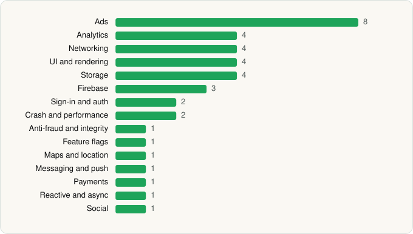

<picture><source media="(prefers-color-scheme: dark)" srcset="../../../../assets/logo/logo-dark.svg"></picture> [Tech Stack](../../../../README.md) / [SKYWORK AI PTE.LTD.](../../../../companies/skywork-ai-pte-ltd.md) / FreeReels

# FreeReels - Dramas & Reels

<picture><source media="(prefers-color-scheme: dark)" srcset="../../../../assets/badges/android-dark.svg"></picture> <picture><source media="(prefers-color-scheme: dark)" srcset="../../../../assets/badges/active-dark.svg"></picture>

[Google Play](https://play.google.com/store/apps/details?id=com.freereels.app) · [latest.json](latest.json)

| | |
|---|---|
| Company | [SKYWORK AI PTE.LTD.](../../../../companies/skywork-ai-pte-ltd.md) |
| Store id | `com.freereels.app` |
| Bundle / package id | `com.freereels.app` |
| Latest version | 2.5.20 (analysed 2026-11-02) |
| Versions tracked | 1 |
| SDKs in latest version | 38 |
| Languages | C/C++ (native), Java, Kotlin, Unity (C# / IL2CPP) |
| UI | Coil, Jetpack Compose, Lottie, Material Components |
| Build | Gradle (inferred) |
| Minimum OS | API 26, targets API 36 |
| Devices / ABIs | Android |
| Capabilities | 8 |
| Declares tracking | Yes |
| Tracked | Yes |

## SDKs by category

<picture><source media="(prefers-color-scheme: dark)" srcset="../../../../assets/charts/apps/android/skywork-ai-pte-ltd/freereels-dark.svg"></picture>

- **Ads** (8): AppLovin, Fyber, Google Ad Manager, Google Mobile Ads (AdMob), Meta Audience Network, Pangle, Unity Ads, Vungle
- **Analytics** (4): AppsFlyer, Facebook SDK, Firebase Analytics, Google App Measurement
- **Networking** (4): Cronet, Cronet (Google), OkHttp, Retrofit
- **UI and rendering** (4): Coil, Jetpack Compose, Lottie, Material Components
- **Storage** (4): DataStore, MMKV, Okio, Room
- **Firebase** (3): Firebase, Google DataTransport, Google Play services
- **Sign-in and auth** (2): Facebook Login, Google Sign-In / Auth
- **Crash and performance** (2): Firebase Crashlytics, Firebase Performance
- **Anti-fraud and integrity** (1): Play Integrity
- **Feature flags** (1): Firebase Remote Config
- **Maps and location** (1): Google Location
- **Messaging and push** (1): Firebase Messaging
- **Payments** (1): Google Play Billing
- **Reactive and async** (1): Kotlin Coroutines
- **Social** (1): Facebook Share

Capabilities (8)

Advertising ID, Bluetooth, Calendar (write), Camera, Foreground service, Notifications, Phone / carrier info, Storage (read)

## Version history

| Version | Analysed | Store update | SDKs | Change | SDK list is a floor | Binary encrypted | File |
|---|---|---|---|---|---|---|---|
| 2.5.20 | 2026-11-02 | 2026-10-27 | 38 |  | No | No | [2.5.20.json](2.5.20.json) |

---

Generated by `scripts/build_readme.py` from the JSON files. Do not edit by hand.
