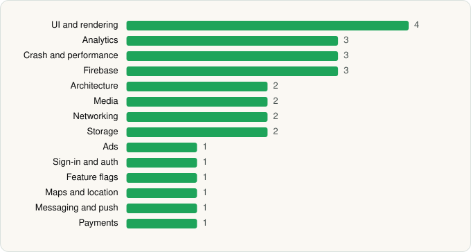

<picture><source media="(prefers-color-scheme: dark)" srcset="../../../../assets/logo/logo-dark.svg"></picture> [Tech Stack](../../../../README.md) / [Sling TV](../../../../companies/sling-tv.md) / SLING

# SLING: Live TV, Shows & Movies

<picture><source media="(prefers-color-scheme: dark)" srcset="../../../../assets/badges/android-dark.svg"></picture> <picture><source media="(prefers-color-scheme: dark)" srcset="../../../../assets/badges/inactive-dark.svg"></picture>

[Google Play](https://play.google.com/store/apps/details?id=com.sling.airtvmini) · [latest.json](latest.json)

| | |
|---|---|
| Company | [Sling TV](../../../../companies/sling-tv.md) |
| Store id | `com.sling.airtvmini` |
| Bundle / package id | `com.sling.airtvmini` |
| Latest version | 9.4.29 (analysed 2026-06-19) |
| Versions tracked | 1 |
| SDKs in latest version | 27 |
| Languages | C/C++ (native), Java, Kotlin, React Native / JavaScript |
| UI | Fresco, Glide, Lottie, Material Components |
| Build | Gradle (inferred) |
| Minimum OS | API 21, targets API 35 |
| Devices / ABIs | Android |
| Capabilities | 11 |
| Declares tracking | Yes |
| Tracked | No. Kept for history. |

## SDKs by category

<picture><source media="(prefers-color-scheme: dark)" srcset="../../../../assets/charts/apps/android/sling-tv/sling-dark.svg"></picture>

- **UI and rendering** (4): Fresco, Glide, Lottie, Material Components
- **Analytics** (3): Branch, comScore, Kochava
- **Crash and performance** (3): Bugsnag, New Relic, OpenTelemetry
- **Firebase** (3): Firebase, Google DataTransport, Google Play services
- **Architecture** (2): CodePush, Redux
- **Media** (2): ExoPlayer, Google Cast
- **Networking** (2): OkHttp, Volley
- **Storage** (2): Realm, Room
- **Ads** (1): Google Mobile Ads (AdMob)
- **Sign-in and auth** (1): Google Sign-In / Auth
- **Feature flags** (1): LaunchDarkly
- **Maps and location** (1): Google Location
- **Messaging and push** (1): Firebase Messaging
- **Payments** (1): Google Play Billing

Capabilities (11)

Advertising ID, Approximate location, Draw over other apps, Foreground service, Microphone, Notifications, Phone / carrier info, Precise location, Query all installed apps, Storage (read), Storage (write)

## Version history

| Version | Analysed | Store update | SDKs | Change | SDK list is a floor | Binary encrypted | File |
|---|---|---|---|---|---|---|---|
| 9.4.29 | 2026-06-19 |  | 27 |  | No | No | [9.4.29.json](9.4.29.json) |

## Model-written summary

> React Native Android streaming app with Hermes, CodePush OTA, LaunchDarkly flags, ExoPlayer+Cast, and Sling/Firebase backends

Written by a language model from the detected signals (`inferred[]`). It is commentary, not measurement.

---

Generated by `scripts/build_readme.py` from the JSON files. Do not edit by hand.
