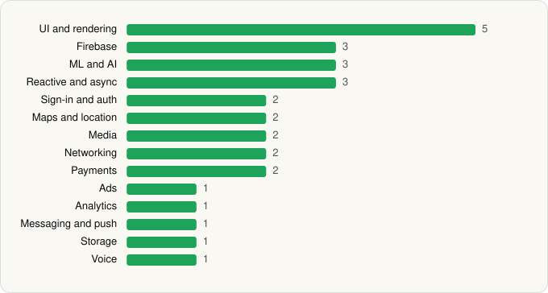

<picture><source media="(prefers-color-scheme: dark)" srcset="../../../../assets/logo/logo-dark.svg"></picture> [Tech Stack](../../../../README.md) / [Snap Inc](../../../../companies/snap-inc.md) / Snapchat

# Snapchat

<picture><source media="(prefers-color-scheme: dark)" srcset="../../../../assets/badges/android-dark.svg"></picture> <picture><source media="(prefers-color-scheme: dark)" srcset="../../../../assets/badges/active-dark.svg"></picture>

[Google Play](https://play.google.com/store/apps/details?id=com.snapchat.android) · [latest.json](latest.json)

| | |
|---|---|
| Company | [Snap Inc](../../../../companies/snap-inc.md) |
| Store id | `com.snapchat.android` |
| Bundle / package id | `com.snapchat.android` |
| Latest version | 14.29.0.50 (analysed 2026-10-24) |
| Versions tracked | 1 |
| SDKs in latest version | 29 |
| Languages | C/C++ (native), Java, Kotlin |
| UI | Fresco, Glide, Jetpack Compose, Material Components |
| Build | Gradle (inferred) |
| Minimum OS | API 23, targets API 36 |
| Devices / ABIs | Android |
| Capabilities | 20 |
| Declares tracking | Yes |
| Tracked | Yes |

## SDKs by category

<picture><source media="(prefers-color-scheme: dark)" srcset="../../../../assets/charts/apps/android/snap-inc/snapchat-dark.svg"></picture>

- **UI and rendering** (5): AndroidSVG, Fresco, Glide, Jetpack Compose, Material Components
- **Firebase** (3): Firebase, Google DataTransport, Google Play services
- **ML and AI** (3): ML Kit, Mobile Vision, OpenCV
- **Reactive and async** (3): Kotlin Coroutines, RxJava, RxJava 3
- **Sign-in and auth** (2): Credential Manager, Google Sign-In / Auth
- **Maps and location** (2): Google Location, Mapbox
- **Media** (2): ExoPlayer, FFmpeg
- **Networking** (2): Cronet, OkHttp
- **Payments** (2): Braintree, Google Play Billing
- **Ads** (1): Google Ad Manager
- **Analytics** (1): Firebase Analytics
- **Messaging and push** (1): Firebase Messaging
- **Storage** (1): Room
- **Voice** (1): WebRTC

Capabilities (20)

Advertising ID, Background location, Biometric auth, Bluetooth, Bluetooth (connect), Bluetooth (scan), Camera, Contacts (read), Fingerprint auth, Foreground service, Foreground service: location, Foreground service: microphone, Media: images, Media: video, Microphone, Notifications, Phone / carrier info, Precise location, Storage (read), Storage (write)

## Version history

| Version | Analysed | Store update | SDKs | Change | SDK list is a floor | Binary encrypted | File |
|---|---|---|---|---|---|---|---|
| 14.29.0.50 | 2026-10-24 | 2026-10-21 | 29 |  | No | No | [14.29.0.50.json](14.29.0.50.json) |

---

Generated by `scripts/build_readme.py` from the JSON files. Do not edit by hand.
