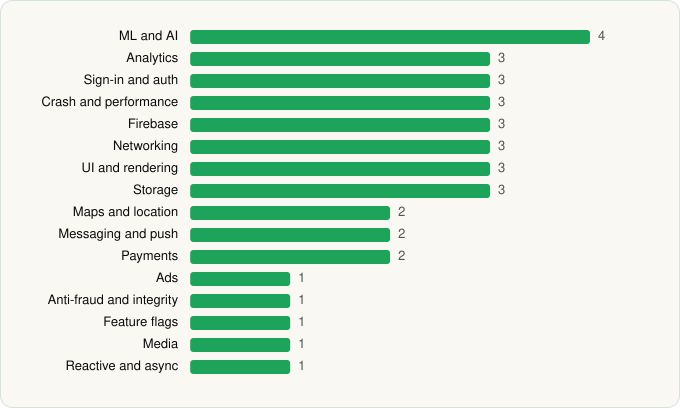

<picture><source media="(prefers-color-scheme: dark)" srcset="../../../../assets/logo/logo-dark.svg"></picture> [Tech Stack](../../../../README.md) / [Social Finance, LLC](../../../../companies/social-finance-llc.md) / SoFi

# SoFi: Bank, Investing & Crypto

<picture><source media="(prefers-color-scheme: dark)" srcset="../../../../assets/badges/android-dark.svg"></picture> <picture><source media="(prefers-color-scheme: dark)" srcset="../../../../assets/badges/inactive-dark.svg"></picture>

[Google Play](https://play.google.com/store/apps/details?id=com.sofi.mobile) · [latest.json](latest.json)

| | |
|---|---|
| Company | [Social Finance, LLC](../../../../companies/social-finance-llc.md) |
| Store id | `com.sofi.mobile` |
| Bundle / package id | `com.sofi.mobile` |
| Latest version | 3.99.0 (analysed 2026-06-19) |
| Versions tracked | 1 |
| SDKs in latest version | 36 |
| Languages | C/C++ (native), Flutter / Dart, Java, Kotlin |
| UI | Jetpack Compose, Material Components, Rive |
| Build | Gradle (inferred) |
| Minimum OS | API 26, targets API 36 |
| Devices / ABIs | Android |
| Capabilities | 12 |
| Declares tracking | Yes |
| Tracked | No. Kept for history. |

## SDKs by category

<picture><source media="(prefers-color-scheme: dark)" srcset="../../../../assets/charts/apps/android/social-finance-llc/sofi-dark.svg"></picture>

- **ML and AI** (4): ML Kit, OpenCV, TensorFlow, TensorFlow Lite
- **Analytics** (3): Branch, Firebase Analytics, Google App Measurement
- **Sign-in and auth** (3): Auth0, Firebase Auth, Google Sign-In / Auth
- **Crash and performance** (3): Datadog, Datadog (native), Firebase Crashlytics
- **Firebase** (3): Firebase, Google DataTransport, Google Play services
- **Networking** (3): Ktor, OkHttp, Retrofit
- **UI and rendering** (3): Jetpack Compose, Material Components, Rive
- **Storage** (3): DataStore, Okio, Room
- **Maps and location** (2): Google Location, Google Maps
- **Messaging and push** (2): Braze, Firebase Messaging
- **Payments** (2): Plaid, Stripe
- **Ads** (1): Google Mobile Ads (AdMob)
- **Anti-fraud and integrity** (1): Play Integrity
- **Feature flags** (1): Firebase Remote Config
- **Media** (1): Media3 (ExoPlayer)
- **Reactive and async** (1): Kotlin Coroutines

Capabilities (12)

Advertising ID, Biometric auth, Camera, Contacts (read), Fingerprint auth, Foreground service, Microphone, Notifications, Phone / carrier info, Precise location, Storage (read), Storage (write)

## Version history

| Version | Analysed | Store update | SDKs | Change | SDK list is a floor | Binary encrypted | File |
|---|---|---|---|---|---|---|---|
| 3.99.0 | 2026-06-19 |  | 36 |  | No | No | [3.99.0.json](3.99.0.json) |

## Model-written summary

> Flutter Android banking app with native TensorFlow Lite, OpenCV, Rive, hybrid Kotlin UI, and 36 SDKs including Plaid and Stripe

Written by a language model from the detected signals (`inferred[]`). It is commentary, not measurement.

---

Generated by `scripts/build_readme.py` from the JSON files. Do not edit by hand.
