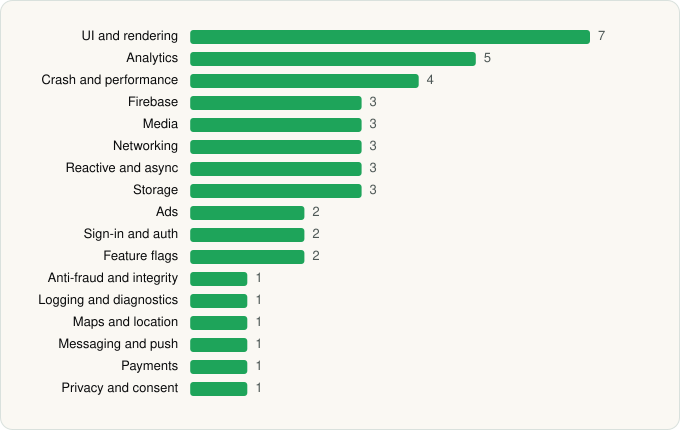

<picture><source media="(prefers-color-scheme: dark)" srcset="../../../../assets/logo/logo-dark.svg"></picture> [Tech Stack](../../../../README.md) / [SoundCloud](../../../../companies/soundcloud.md) / SoundCloud

# SoundCloud: The Music You Love

<picture><source media="(prefers-color-scheme: dark)" srcset="../../../../assets/badges/android-dark.svg"></picture> <picture><source media="(prefers-color-scheme: dark)" srcset="../../../../assets/badges/inactive-dark.svg"></picture>

[Google Play](https://play.google.com/store/apps/details?id=com.soundcloud.android) · [latest.json](latest.json)

| | |
|---|---|
| Company | [SoundCloud](../../../../companies/soundcloud.md) |
| Store id | `com.soundcloud.android` |
| Bundle / package id | `com.soundcloud.android` |
| Latest version | 2026.05.29-release (analysed 2026-06-19) |
| Versions tracked | 1 |
| SDKs in latest version | 43 |
| Languages | C/C++ (native), Java, Kotlin |
| UI | Coil, Glide, Jetpack Compose, Lottie, Material Components, Picasso, Rive |
| Build | Gradle (inferred) |
| Minimum OS | API 28, targets API 36 |
| Devices / ABIs | Android |
| Capabilities | 5 |
| Declares tracking | Yes |
| Tracked | No. Kept for history. |

## SDKs by category

<picture><source media="(prefers-color-scheme: dark)" srcset="../../../../assets/charts/apps/android/soundcloud/soundcloud-dark.svg"></picture>

- **UI and rendering** (7): Coil, Glide, Jetpack Compose, Lottie, Material Components, Picasso, Rive
- **Analytics** (5): AppsFlyer, comScore, Firebase Analytics, Google App Measurement, Segment
- **Crash and performance** (4): Firebase Crashlytics, Firebase Performance, Sentry, Sentry (native)
- **Firebase** (3): Firebase, Google DataTransport, Google Play services
- **Media** (3): ExoPlayer, Google Cast, Media3 (ExoPlayer)
- **Networking** (3): OkHttp, Retrofit, Volley
- **Reactive and async** (3): Kotlin Coroutines, RxJava, RxJava 3
- **Storage** (3): DataStore, Okio, Room
- **Ads** (2): Google Mobile Ads (AdMob), Meta Audience Network
- **Sign-in and auth** (2): Firebase Auth, Google Sign-In / Auth
- **Feature flags** (2): Firebase Remote Config, Statsig
- **Anti-fraud and integrity** (1): Play Integrity
- **Logging and diagnostics** (1): LeakCanary
- **Maps and location** (1): Google Location
- **Messaging and push** (1): Firebase Messaging
- **Payments** (1): Google Play Billing
- **Privacy and consent** (1): OneTrust

Capabilities (5)

Advertising ID, Foreground service, Foreground service: media playback, Notifications, Phone / carrier info

## Version history

| Version | Analysed | Store update | SDKs | Change | SDK list is a floor | Binary encrypted | File |
|---|---|---|---|---|---|---|---|
| 2026.05.29-release | 2026-06-19 |  | 43 |  | No | No | [2026.05.29-release.json](2026.05.29-release.json) |

## Model-written summary

> Android SoundCloud client in Kotlin/Java with Jetpack Compose, Rive, ExoPlayer, dynamic DexClassLoader loading, root detection, first-party SoundCloud APIs, and multi-vendor analytics.

Written by a language model from the detected signals (`inferred[]`). It is commentary, not measurement.

---

Generated by `scripts/build_readme.py` from the JSON files. Do not edit by hand.
