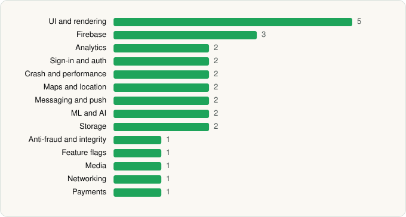

<picture><source media="(prefers-color-scheme: dark)" srcset="../../../../assets/logo/logo-dark.svg"></picture> [Tech Stack](../../../../README.md) / [SpaceX Super Intelligence](../../../../companies/spacex-super-intelligence.md) / Grok Bot

# Grok Bot

<picture><source media="(prefers-color-scheme: dark)" srcset="../../../../assets/badges/android-dark.svg"></picture> <picture><source media="(prefers-color-scheme: dark)" srcset="../../../../assets/badges/active-dark.svg"></picture> <picture><source media="(prefers-color-scheme: dark)" srcset="../../../../assets/badges/floor-dark.svg"></picture>

[Google Play](https://play.google.com/store/apps/details?id=ai.x.grok.bot) · [latest.json](latest.json)

| | |
|---|---|
| Company | [SpaceX Super Intelligence](../../../../companies/spacex-super-intelligence.md) |
| Store id | `ai.x.grok.bot` |
| Bundle / package id | `ai.x.grok.bot` |
| Latest version | 1.19.1 (analysed 2026-11-05) |
| Versions tracked | 2 |
| SDKs in latest version | 27 |
| Languages | C/C++ (native), Java, Kotlin, React Native / JavaScript |
| UI | Fresco, Glide, Jetpack Compose, Material Components |
| Build | Gradle (inferred), Packer/hardening: Google Play (pairip) anti-tamper, R8 / ProGuard (name obfuscation detected) |
| Minimum OS | API 28, targets API 36 |
| Devices / ABIs | Android |
| Capabilities | 16 |
| Declares tracking | Yes |
| Tracked | Yes |

## SDKs by category

<picture><source media="(prefers-color-scheme: dark)" srcset="../../../../assets/charts/apps/android/spacex-super-intelligence/grok-bot-dark.svg"></picture>

- **UI and rendering** (5): Fresco, Glide, Jetpack Compose, Material Components, React Native Reanimated
- **Firebase** (3): Firebase, Google DataTransport, Google Play services
- **Analytics** (2): AppsFlyer, Branch
- **Sign-in and auth** (2): Credential Manager, Google Sign-In / Auth
- **Crash and performance** (2): Sentry, Sentry (native)
- **Maps and location** (2): Google Location, Google Maps
- **Messaging and push** (2): Braze, Firebase Messaging
- **ML and AI** (2): ML Kit, ML Kit (barcode/vision)
- **Storage** (2): DataStore, Room
- **Anti-fraud and integrity** (1): Play Integrity
- **Feature flags** (1): Statsig
- **Media** (1): Media3 (ExoPlayer)
- **Networking** (1): OkHttp
- **Payments** (1): Google Play Billing

Capabilities (16)

Advertising ID, Approximate location, Biometric auth, Calendar (read), Calendar (write), Camera, Contacts (read), Contacts (write), Draw over other apps, Fingerprint auth, Foreground service, Foreground service: microphone, Microphone, Notifications, Precise location, Storage (write)

## Version history

| Version | Analysed | Store update | SDKs | Change | SDK list is a floor | Binary encrypted | File |
|---|---|---|---|---|---|---|---|
| 1.19.1 | 2026-11-05 | 2026-11-04 | 27 | +9 / −2 | Yes | No | [1.19.1.json](1.19.1.json) |
| 1.5.0 | 2026-09-02 |  | 20 |  | Yes | No | [1.5.0.json](1.5.0.json) |

### SDK changes between versions

- 1.5.0 → 1.19.1: added AppsFlyer, Braze, Credential Manager, Google Location, Google Maps, ML Kit, ML Kit (barcode/vision), Play Integrity, React Native Reanimated; removed Amplitude, react-native-svg

---

Generated by `scripts/build_readme.py` from the JSON files. Do not edit by hand.
