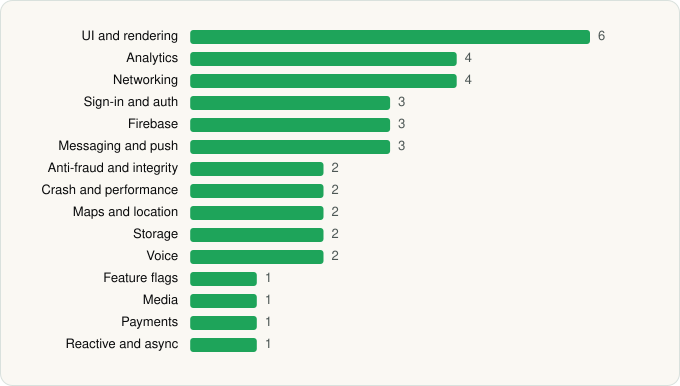

<picture><source media="(prefers-color-scheme: dark)" srcset="../../../../assets/logo/logo-dark.svg"></picture> [Tech Stack](../../../../README.md) / [SpaceX Super Intelligence](../../../../companies/spacex-super-intelligence.md) / Grok

# Grok - AI Chat & Video

<picture><source media="(prefers-color-scheme: dark)" srcset="../../../../assets/badges/android-dark.svg"></picture> <picture><source media="(prefers-color-scheme: dark)" srcset="../../../../assets/badges/active-dark.svg"></picture> <picture><source media="(prefers-color-scheme: dark)" srcset="../../../../assets/badges/floor-dark.svg"></picture>

[Google Play](https://play.google.com/store/apps/details?id=ai.x.grok) · [latest.json](latest.json)

| | |
|---|---|
| Company | [SpaceX Super Intelligence](../../../../companies/spacex-super-intelligence.md) |
| Store id | `ai.x.grok` |
| Bundle / package id | `ai.x.grok` |
| Latest version | 1.2.53-release.00 (analysed 2026-11-04) |
| Versions tracked | 2 |
| SDKs in latest version | 36 |
| Languages | C/C++ (native), Java, Kotlin |
| UI | Coil, Jetpack Compose, Material Components |
| Build | Gradle (inferred), R8 / ProGuard (name obfuscation detected) |
| Minimum OS | API 29, targets API 36 |
| Devices / ABIs | Android |
| Capabilities | 13 |
| Declares tracking | Yes |
| Tracked | Yes |

## SDKs by category

<picture><source media="(prefers-color-scheme: dark)" srcset="../../../../assets/charts/apps/android/spacex-super-intelligence/grok-dark.svg"></picture>

- **UI and rendering** (6): AndroidSVG, Coil, Jetpack Compose, jLaTeXMath, Markwon, Material Components
- **Networking** (5): Cronet, Cronet (Google), Ktor, OkHttp, Retrofit
- **Analytics** (4): AppsFlyer, Firebase Analytics, Google App Measurement, Mixpanel
- **Firebase** (3): Firebase, Google DataTransport, Google Play services
- **Messaging and push** (3): Braze, Firebase Messaging, Intercom
- **Sign-in and auth** (2): Credential Manager, Google Sign-In / Auth
- **Crash and performance** (2): Firebase Crashlytics, Firebase Performance
- **Maps and location** (2): Google Location, Google Maps
- **Payments** (2): Google Play Billing, Plaid
- **Storage** (2): DataStore, Room
- **Anti-fraud and integrity** (1): Play Integrity
- **Feature flags** (1): Firebase Remote Config
- **Media** (1): Media3 (ExoPlayer)
- **ML and AI** (1): ML Kit
- **Reactive and async** (1): Kotlin Coroutines

Capabilities (13)

Advertising ID, Approximate location, Biometric auth, Camera, Fingerprint auth, Foreground service, Foreground service: media playback, Foreground service: microphone, Media: images, Microphone, Notifications, Storage (read), Storage (write)

## Version history

| Version | Analysed | Store update | SDKs | Change | SDK list is a floor | Binary encrypted | File |
|---|---|---|---|---|---|---|---|
| 1.2.53-release.00 | 2026-11-04 | 2026-10-29 | 36 | +4 / −5 | Yes | No | [1.2.53-release.00.json](1.2.53-release.00.json) |
| 1.1.78-release.02 | 2026-06-23 |  | 37 |  | Yes | No | [1.1.78-release.02.json](1.1.78-release.02.json) |

### SDK changes between versions

- 1.1.78-release.02 → 1.2.53-release.00: added Cronet, Cronet (Google), ML Kit, Plaid; removed Auth0, LiveKit, RootBeer, Volley, WebRTC

---

Generated by `scripts/build_readme.py` from the JSON files. Do not edit by hand.
