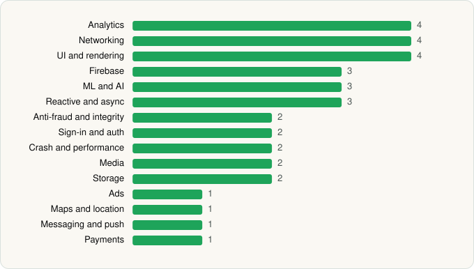

<picture><source media="(prefers-color-scheme: dark)" srcset="../../../../assets/logo/logo-dark.svg"></picture> [Tech Stack](../../../../README.md) / [Spotify](../../../../companies/spotify.md) / Spotify

# Spotify: Music and Podcasts

<picture><source media="(prefers-color-scheme: dark)" srcset="../../../../assets/badges/android-dark.svg"></picture> <picture><source media="(prefers-color-scheme: dark)" srcset="../../../../assets/badges/active-dark.svg"></picture>

[Google Play](https://play.google.com/store/apps/details?id=com.spotify.music) · [latest.json](latest.json)

| | |
|---|---|
| Company | [Spotify](../../../../companies/spotify.md) |
| Store id | `com.spotify.music` |
| Bundle / package id | `com.spotify.music` |
| Latest version | 9.1.52.1394 (analysed 2026-06-23) |
| Versions tracked | 1 |
| SDKs in latest version | 35 |
| Languages | C/C++ (native), Java, Kotlin |
| UI | Coil, Jetpack Compose, Lottie, Material Components |
| Build | Gradle (inferred) |
| Minimum OS | API 24, targets API 36 |
| Devices / ABIs | Android |
| Capabilities | 16 |
| Declares tracking | Yes |
| Tracked | Yes |

## SDKs by category

<picture><source media="(prefers-color-scheme: dark)" srcset="../../../../assets/charts/apps/android/spotify/spotify-dark.svg"></picture>

- **Analytics** (4): Branch, comScore, Facebook SDK, Firebase Analytics
- **Networking** (4): Cronet, Cronet (Google), OkHttp, Retrofit
- **UI and rendering** (4): Coil, Jetpack Compose, Lottie, Material Components
- **Firebase** (3): Firebase, Google DataTransport, Google Play services
- **ML and AI** (3): ML Kit, TensorFlow, TensorFlow Lite
- **Reactive and async** (3): Kotlin Coroutines, RxJava, RxJava 3
- **Anti-fraud and integrity** (2): Play Integrity, reCAPTCHA
- **Sign-in and auth** (2): Credential Manager, Google Sign-In / Auth
- **Crash and performance** (2): Crashlytics, Firebase Crashlytics
- **Media** (2): Google Cast, Media3 (ExoPlayer)
- **Storage** (2): DataStore, Room
- **Ads** (1): Google Mobile Ads (AdMob)
- **Maps and location** (1): Google Maps
- **Messaging and push** (1): Firebase Messaging
- **Payments** (1): Google Play Billing

Capabilities (16)

Advertising ID, Approximate location, Bluetooth, Bluetooth (connect), Bluetooth (scan), Camera, Foreground service, Foreground service: media playback, Media: audio, Microphone, NFC, Notifications, Phone / carrier info, Precise location, Storage (read), Storage (write)

## Version history

| Version | Analysed | Store update | SDKs | Change | SDK list is a floor | Binary encrypted | File |
|---|---|---|---|---|---|---|---|
| 9.1.52.1394 | 2026-06-23 |  | 35 |  | No | No | [9.1.52.1394.json](9.1.52.1394.json) |

## Model-written summary

> Kotlin/Java Android Spotify client with Jetpack Compose, native TensorFlow Lite, 10 JNI libs, Firebase, and 35 third-party SDKs

Written by a language model from the detected signals (`inferred[]`). It is commentary, not measurement.

---

Generated by `scripts/build_readme.py` from the JSON files. Do not edit by hand.
