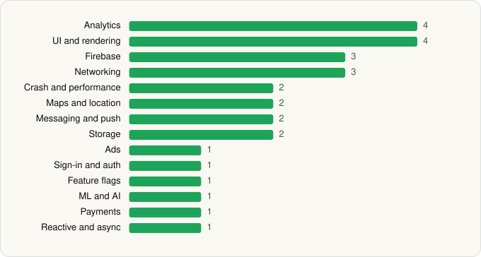

<picture><source media="(prefers-color-scheme: dark)" srcset="../../../../assets/logo/logo-dark.svg"></picture> [Tech Stack](../../../../README.md) / [Starbucks Coffee Company](../../../../companies/starbucks-coffee-company.md) / Starbucks

# Starbucks

<picture><source media="(prefers-color-scheme: dark)" srcset="../../../../assets/badges/android-dark.svg"></picture> <picture><source media="(prefers-color-scheme: dark)" srcset="../../../../assets/badges/inactive-dark.svg"></picture>

[Google Play](https://play.google.com/store/apps/details?id=com.starbucks.mobilecard) · [latest.json](latest.json)

| | |
|---|---|
| Company | [Starbucks Coffee Company](../../../../companies/starbucks-coffee-company.md) |
| Store id | `com.starbucks.mobilecard` |
| Bundle / package id | `com.starbucks.mobilecard` |
| Latest version | 6.124 (analysed 2026-06-19) |
| Versions tracked | 1 |
| SDKs in latest version | 28 |
| Languages | C/C++ (native), Java, Kotlin |
| UI | Glide, Jetpack Compose, Lottie, Material Components |
| Build | Gradle (inferred) |
| Minimum OS | API 29, targets API 36 |
| Devices / ABIs | Android |
| Capabilities | 10 |
| Declares tracking | Yes |
| Tracked | No. Kept for history. |

## SDKs by category

<picture><source media="(prefers-color-scheme: dark)" srcset="../../../../assets/charts/apps/android/starbucks-coffee-company/starbucks-dark.svg"></picture>

- **Analytics** (4): Adobe Experience Platform, Branch, Firebase Analytics, Google App Measurement
- **UI and rendering** (4): Glide, Jetpack Compose, Lottie, Material Components
- **Firebase** (3): Firebase, Google DataTransport, Google Play services
- **Networking** (3): Ktor, OkHttp, Volley
- **Crash and performance** (2): Firebase Crashlytics, New Relic
- **Maps and location** (2): Google Location, Google Maps
- **Messaging and push** (2): Airship, Firebase Messaging
- **Storage** (2): Okio, Realm
- **Ads** (1): Google Mobile Ads (AdMob)
- **Sign-in and auth** (1): Google Sign-In / Auth
- **Feature flags** (1): Firebase Remote Config
- **ML and AI** (1): ML Kit
- **Payments** (1): Braintree
- **Reactive and async** (1): Kotlin Coroutines

Capabilities (10)

Advertising ID, Approximate location, Biometric auth, Camera, Contacts (read), Fingerprint auth, Foreground service, Foreground service: location, Notifications, Precise location

## Version history

| Version | Analysed | Store update | SDKs | Change | SDK list is a floor | Binary encrypted | File |
|---|---|---|---|---|---|---|---|
| 6.124 | 2026-06-19 |  | 28 |  | No | No | [6.124.json](6.124.json) |

## Model-written summary

> Android Starbucks app in Kotlin/Java using Jetpack Compose, three TFLite ML models, native C++ with Realm, Firebase, New Relic crash reporting and Braintree payments

Written by a language model from the detected signals (`inferred[]`). It is commentary, not measurement.

---

Generated by `scripts/build_readme.py` from the JSON files. Do not edit by hand.
