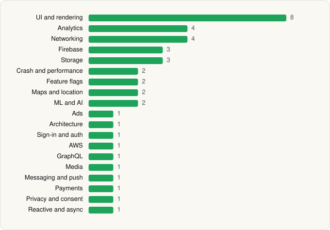

<picture><source media="(prefers-color-scheme: dark)" srcset="../../../../assets/logo/logo-dark.svg"></picture> [Tech Stack](../../../../README.md) / [SUBWAY Restaurants](../../../../companies/subway-restaurants.md) / Subway®

# Subway®

<picture><source media="(prefers-color-scheme: dark)" srcset="../../../../assets/badges/android-dark.svg"></picture> <picture><source media="(prefers-color-scheme: dark)" srcset="../../../../assets/badges/inactive-dark.svg"></picture>

[Google Play](https://play.google.com/store/apps/details?id=com.subway.mobile.subwayapp03) · [latest.json](latest.json)

| | |
|---|---|
| Company | [SUBWAY Restaurants](../../../../companies/subway-restaurants.md) |
| Store id | `com.subway.mobile.subwayapp03` |
| Bundle / package id | `com.subway.mobile.subwayapp03` |
| Latest version | 101.4.4 (analysed 2026-06-22) |
| Versions tracked | 1 |
| SDKs in latest version | 40 |
| Languages | C/C++ (native), Java, Kotlin, React Native / JavaScript |
| UI | Fresco, Glide, Jetpack Compose, Material Components |
| Build | Gradle (inferred) |
| Minimum OS | API 29, targets API 36 |
| Devices / ABIs | Android |
| Capabilities | 11 |
| Declares tracking | Yes |
| Tracked | No. Kept for history. |

## SDKs by category

<picture><source media="(prefers-color-scheme: dark)" srcset="../../../../assets/charts/apps/android/subway-restaurants/subway-dark.svg"></picture>

- **UI and rendering** (8): AndroidSVG, FlashList, Fresco, Glide, Jetpack Compose, Material Components, React Native Reanimated, react-native-svg
- **Analytics** (4): Adobe Experience Platform, Amplitude, Branch, Firebase Analytics
- **Networking** (4): axios, OkHttp, Retrofit, Volley
- **Firebase** (3): Firebase, Google DataTransport, Google Play services
- **Storage** (3): DataStore, Okio, Room
- **Crash and performance** (2): Sentry, Sentry (native)
- **Feature flags** (2): LaunchDarkly, Statsig
- **Maps and location** (2): Google Location, Google Maps
- **ML and AI** (2): ML Kit, ML Kit (barcode/vision)
- **Ads** (1): Google Mobile Ads (AdMob)
- **Architecture** (1): Redux
- **Sign-in and auth** (1): Google Sign-In / Auth
- **AWS** (1): AWS SDK
- **GraphQL** (1): Apollo GraphQL
- **Media** (1): Media3 (ExoPlayer)
- **Messaging and push** (1): Firebase Messaging
- **Payments** (1): Adyen
- **Privacy and consent** (1): OneTrust
- **Reactive and async** (1): Kotlin Coroutines

Capabilities (11)

Advertising ID, Approximate location, Biometric auth, Draw over other apps, Fingerprint auth, Foreground service, Microphone, Notifications, Precise location, Storage (read), Storage (write)

## Version history

| Version | Analysed | Store update | SDKs | Change | SDK list is a floor | Binary encrypted | File |
|---|---|---|---|---|---|---|---|
| 101.4.4 | 2026-06-22 |  | 40 |  | No | No | [101.4.4.json](101.4.4.json) |

---

Generated by `scripts/build_readme.py` from the JSON files. Do not edit by hand.
