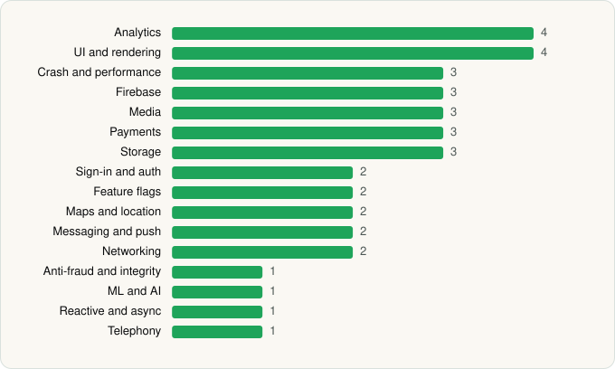

<picture><source media="(prefers-color-scheme: dark)" srcset="../../../../assets/logo/logo-dark.svg"></picture> [Tech Stack](../../../../README.md) / [Suno, Inc](../../../../companies/suno-inc.md) / Suno

# Suno - AI Music & Songs Maker

<picture><source media="(prefers-color-scheme: dark)" srcset="../../../../assets/badges/android-dark.svg"></picture> <picture><source media="(prefers-color-scheme: dark)" srcset="../../../../assets/badges/active-dark.svg"></picture>

[Google Play](https://play.google.com/store/apps/details?id=com.suno.android) · [latest.json](latest.json)

| | |
|---|---|
| Company | [Suno, Inc](../../../../companies/suno-inc.md) |
| Store id | `com.suno.android` |
| Bundle / package id | `com.suno.android` |
| Latest version | 1.94.0 (analysed 2026-10-24) |
| Versions tracked | 1 |
| SDKs in latest version | 37 |
| Languages | C/C++ (native), Java, Kotlin |
| UI | Coil, Jetpack Compose, Material Components |
| Build | Gradle (inferred) |
| Minimum OS | API 29, targets API 36 |
| Devices / ABIs | Android |
| Capabilities | 11 |
| Declares tracking | Yes |
| Tracked | Yes |

## SDKs by category

<picture><source media="(prefers-color-scheme: dark)" srcset="../../../../assets/charts/apps/android/suno-inc/suno-dark.svg"></picture>

- **Analytics** (4): Firebase Analytics, Google App Measurement, Segment, Singular
- **UI and rendering** (4): AndroidSVG, Coil, Jetpack Compose, Material Components
- **Crash and performance** (3): Datadog, Firebase Crashlytics, Firebase Performance
- **Firebase** (3): Firebase, Google DataTransport, Google Play services
- **Media** (3): FFmpeg, Google Cast, Media3 (ExoPlayer)
- **Payments** (3): Google Play Billing, RevenueCat, Stripe
- **Storage** (3): DataStore, Room, SQLDelight
- **Sign-in and auth** (2): Credential Manager, Google Sign-In / Auth
- **Feature flags** (2): Firebase Remote Config, Statsig
- **Maps and location** (2): Google Location, Google Maps
- **Messaging and push** (2): Braze, Firebase Messaging
- **Networking** (2): OkHttp, Retrofit
- **Anti-fraud and integrity** (1): Play Integrity
- **ML and AI** (1): ML Kit
- **Reactive and async** (1): Kotlin Coroutines
- **Telephony** (1): libphonenumber

Capabilities (11)

Advertising ID, Biometric auth, Camera, Fingerprint auth, Foreground service, Foreground service: media playback, Media: audio, Microphone, Notifications, Storage (read), Storage (write)

## Version history

| Version | Analysed | Store update | SDKs | Change | SDK list is a floor | Binary encrypted | File |
|---|---|---|---|---|---|---|---|
| 1.94.0 | 2026-10-24 | 2026-10-20 | 37 |  | No | No | [1.94.0.json](1.94.0.json) |

---

Generated by `scripts/build_readme.py` from the JSON files. Do not edit by hand.
