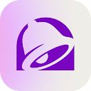
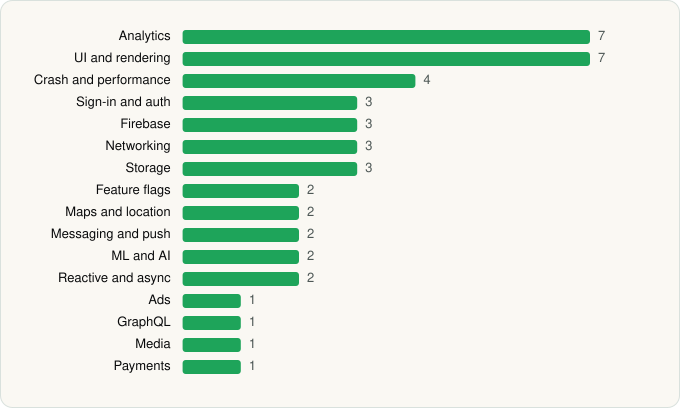

<picture><source media="(prefers-color-scheme: dark)" srcset="../../../../assets/logo/logo-dark.svg"></picture> [Tech Stack](../../../../README.md) / [Taco Bell Mobile](../../../../companies/taco-bell-mobile.md) / Taco Bell Fast Food & Delivery

# Taco Bell Fast Food & Delivery

<picture><source media="(prefers-color-scheme: dark)" srcset="../../../../assets/badges/android-dark.svg"></picture> <picture><source media="(prefers-color-scheme: dark)" srcset="../../../../assets/badges/inactive-dark.svg"></picture>

[Google Play](https://play.google.com/store/apps/details?id=com.tacobell.ordering) · [latest.json](latest.json)

| | |
|---|---|
| Company | [Taco Bell Mobile](../../../../companies/taco-bell-mobile.md) |
| Store id | `com.tacobell.ordering` |
| Bundle / package id | `com.tacobell.ordering` |
| Latest version | 8.90.0 (analysed 2026-06-19) |
| Versions tracked | 1 |
| SDKs in latest version | 44 |
| Languages | C/C++ (native), Java, Kotlin |
| UI | Coil, Glide, Jetpack Compose, Lottie, Material Components |
| Build | Gradle (inferred) |
| Minimum OS | API 28, targets API 35 |
| Devices / ABIs | Android |
| Capabilities | 12 |
| Declares tracking | Yes |
| Tracked | No. Kept for history. |

## SDKs by category

<picture><source media="(prefers-color-scheme: dark)" srcset="../../../../assets/charts/apps/android/taco-bell-mobile/taco-bell-fast-food-delivery-dark.svg"></picture>

- **Analytics** (7): Amplitude, AppsFlyer, Facebook SDK, Firebase Analytics, FullStory, Google Analytics (legacy), Google App Measurement
- **UI and rendering** (7): Coil, Florent37 UI, Glide, Jetpack Compose, Lottie, Markwon, Material Components
- **Crash and performance** (4): Embrace, Firebase Crashlytics, Firebase Performance, OpenTelemetry
- **Sign-in and auth** (3): AppAuth, Firebase Auth, Google Sign-In / Auth
- **Firebase** (3): Firebase, Google DataTransport, Google Play services
- **Networking** (3): OkHttp, Retrofit, Volley
- **Storage** (3): DataStore, Okio, Room
- **Feature flags** (2): Firebase Remote Config, Optimizely
- **Maps and location** (2): Google Location, Google Maps
- **Messaging and push** (2): Braze, Firebase Messaging
- **ML and AI** (2): ML Kit, ML Kit (barcode/vision)
- **Reactive and async** (2): Kotlin Coroutines, RxJava
- **Ads** (1): Google Mobile Ads (AdMob)
- **GraphQL** (1): Apollo GraphQL
- **Media** (1): ExoPlayer
- **Payments** (1): Braintree

Capabilities (12)

Advertising ID, Approximate location, Background location, Bluetooth, Camera, Fingerprint auth, Foreground service, Notifications, Phone / carrier info, Precise location, Storage (read), Storage (write)

## Version history

| Version | Analysed | Store update | SDKs | Change | SDK list is a floor | Binary encrypted | File |
|---|---|---|---|---|---|---|---|
| 8.90.0 | 2026-06-19 |  | 44 |  | No | No | [8.90.0.json](8.90.0.json) |

---

Generated by `scripts/build_readme.py` from the JSON files. Do not edit by hand.
