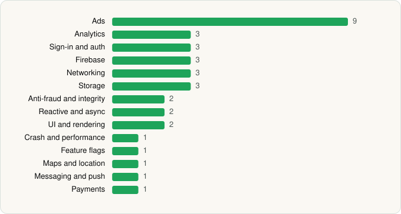

<picture><source media="(prefers-color-scheme: dark)" srcset="../../../../assets/logo/logo-dark.svg"></picture> [Tech Stack](../../../../README.md) / [Tapps Games](../../../../companies/tapps-games.md) / Goat Evolution

# Goat Evolution: Animal Merge

<picture><source media="(prefers-color-scheme: dark)" srcset="../../../../assets/badges/android-dark.svg"></picture> <picture><source media="(prefers-color-scheme: dark)" srcset="../../../../assets/badges/active-dark.svg"></picture>

[Google Play](https://play.google.com/store/apps/details?id=br.com.tapps.goatevolution) · [latest.json](latest.json)

| | |
|---|---|
| Company | [Tapps Games](../../../../companies/tapps-games.md) |
| Store id | `br.com.tapps.goatevolution` |
| Bundle / package id | `br.com.tapps.goatevolution` |
| Latest version | 1.3.75 (analysed 2026-06-23) |
| Versions tracked | 1 |
| SDKs in latest version | 35 |
| Languages | C/C++ (native), Java, Kotlin, Unity (C# / IL2CPP) |
| UI | Glide, Picasso |
| Build | Gradle (inferred) |
| Minimum OS | API 26, targets API 35 |
| Devices / ABIs | Android |
| Capabilities | 5 |
| Declares tracking | Yes |
| Tracked | Yes |

## SDKs by category

<picture><source media="(prefers-color-scheme: dark)" srcset="../../../../assets/charts/apps/android/tapps-games/goat-evolution-dark.svg"></picture>

- **Ads** (9): AppLovin, Fyber, Google Mobile Ads (AdMob), ironSource, Meta Audience Network, Mintegral, Pangle, Unity Ads, Vungle
- **Analytics** (3): Firebase Analytics, Google App Measurement, Singular
- **Sign-in and auth** (3): Credential Manager, Firebase Auth, Google Sign-In / Auth
- **Firebase** (3): Firebase, Google DataTransport, Google Play services
- **Networking** (3): Cronet, Cronet (Google), OkHttp
- **Storage** (3): DataStore, Okio, Room
- **Anti-fraud and integrity** (2): Play Integrity, reCAPTCHA
- **Reactive and async** (2): Kotlin Coroutines, RxJava
- **UI and rendering** (2): Glide, Picasso
- **Crash and performance** (1): Firebase Crashlytics
- **Feature flags** (1): Firebase Remote Config
- **Maps and location** (1): Google Location
- **Messaging and push** (1): Firebase Messaging
- **Payments** (1): Google Play Billing

Capabilities (5)

Advertising ID, Foreground service, Notifications, Storage (read), Storage (write)

## Version history

| Version | Analysed | Store update | SDKs | Change | SDK list is a floor | Binary encrypted | File |
|---|---|---|---|---|---|---|---|
| 1.3.75 | 2026-06-23 |  | 35 |  | No | No | [1.3.75.json](1.3.75.json) |

## Model-written summary

> Unity Android game with IL2CPP, 13 native JNI libs, Firebase Realtime DB backend and nine ad networks

Written by a language model from the detected signals (`inferred[]`). It is commentary, not measurement.

---

Generated by `scripts/build_readme.py` from the JSON files. Do not edit by hand.
